# 接触辅助不变扩展卡尔曼滤波：机器人状态估计

**Ross Hartley、Maani Ghaffari、Ryan M. Eustice、Jessy W. Grizzle**  
arXiv:1904.09251v2，2019 年 11 月 13 日

## 摘要

腿式机器人需要准确的位姿和速度信息，才能保持稳定并按规划路径行走。现有方法要么依赖容易受环境与光照影响的视觉数据，要么融合惯性测量单元（IMU）与运动学、接触信息。本文基于李群理论和不变观测器设计，构造一种接触辅助不变扩展卡尔曼滤波器（InEKF）。该滤波器将接触—惯性动力学与正向运动学校正结合起来，同时估计位姿、速度和当前所有接触点。

作者证明，误差动力学满足自治的对数线性微分方程。由此，系统可观测状态的收敛域不依赖机器人轨迹；与标准扩展卡尔曼滤波器（EKF）不同，线性化误差动力学和线性化观测模型都不依赖当前状态估计，从而改善收敛性；局部可观测性矩阵也与底层非线性系统一致。文中进一步说明如何纳入 IMU 偏置、增删接触点，以及构造世界中心和机器人中心两种形式。作者通过仿真和 Cassie 双足机器人的实验，将所提 InEKF 与常用的四元数 EKF 比较，并利用运动捕捉分析滤波精度，最后展示了激光雷达建图应用。结果表明，利用系统对称性设计的接触辅助 InEKF 性能优于四元数 EKF。

**关键词：** 不变扩展卡尔曼滤波器；不变观测器；卡尔曼滤波；腿式机器人；惯性导航；接触辅助导航；状态估计；同步定位与建图（SLAM）；Cassie 机器人；李群。

## 1. 引言

腿式机器人有望用于物流配送、家庭助理以及搜救任务。运动规划与反馈控制需要准确的机器人状态。关节角可由编码器直接测得；机体位姿和速度则通常需要融合传感器数据。IMU 能测量线加速度和角速度，但读数含噪声和偏置，因此常使用非线性观测器融合腿部里程计和惯性测量，估计轨迹、速度及标定参数。扩展卡尔曼滤波器计算效率高、易于定制，已应用于多种满足实时要求的腿式机器人；但其局部线性化通常只有局部收敛性质。

位姿估计可以与视觉数据结合构建地图，并用于不平地形上的步态选择和高层运动规划。视觉惯性里程计和 SLAM 已取得进展，但依赖视觉会使观测器和反馈控制器受到快速光照变化及工作环境的影响。因此，作者主张构造仅融合本体感觉数据的底层状态估计器，以提供高频、准确的状态估计。Bloesch 等人提出四元数 EKF（QEKF），融合惯性、接触和运动学信息，估计机器人基座位姿、速度及若干接触状态。本文沿着这一思路，进一步使用不变扩展卡尔曼滤波器（InEKF），以改善收敛性和一致性，支持长期自主运行。

不变观测器理论要求估计误差在矩阵李群作用下保持不变。若状态定义在李群上，且动力学满足特定的“群仿射”性质，则误差在李代数上满足自治的对数线性微分方程。在确定性条件下，该线性系统可以精确恢复群上的非线性状态误差。作者将 IMU 与接触传感器动力学、正向运动学校正结合，推导右不变 EKF，并讨论可观测性、IMU 偏置扩维、左右不变形式之间的转换、世界中心与机器人中心表达，以及滤波器的解析离散化。实现频率可超过 2000 Hz。贡献还包括在 Cassie 双足机器人仿真和硬件实验中评估方法，以及发布辅助惯性导航 InEKF 的开源 C++ 库。

## 2. 背景与相关工作

### 2.1 卡尔曼滤波

当过程模型和测量模型为线性、噪声为白噪声且服从高斯分布时，卡尔曼滤波给出最小均方误差意义下的最优状态估计。滤波包含传播和校正两步：传播时根据系统动力学将上一时刻的状态均值与协方差向前推进；获得测量后，再根据观测模型及测量噪声协方差校正状态和协方差。实际机器人系统通常是非线性的，因此使用泰勒展开对模型作局部线性化，形成 EKF。

另一个常见方案是无迹卡尔曼滤波（UKF）：从状态分布中选取有限个 sigma 点，通过非线性模型传播这些点，以近似变换后的概率分布。它避免显式求取雅可比，但对高维系统计算量较大。若先将状态变换到李代数再作欧氏线性化，结果通常仍与 EKF 相同，因为一阶线性化精度取决于所选误差变量。

### 2.2 腿式机器人与人形机器人状态估计

早期研究利用动力学模型、IMU 与运动学测量估计机器人状态；另一些方法只使用本体感觉数据和粒子滤波，通过足端接触时的运动学约束辅助定位。Bloesch 等人将惯性与运动学测量结合，在状态中增广所有当前接触足的位置；预测阶段允许足端接触位置作布朗运动以建模滑移，校正阶段使用正向运动学位置测量。后续工作也使用足端朝向或速度观测，并研究接触检测及与计算机视觉融合。

这种惯性—运动学滤波能够估计基座位姿和速度，但在没有外部参考时，绝对位置和绕重力方向的偏航角不可观测，会随时间漂移。视觉或激光雷达可以提供全局定位校正；但本文聚焦于 IMU、关节编码器和接触信息构成的本体感觉方案。与将各状态分开处理的传统方法不同，本文把完整状态写成一个矩阵李群，以利用问题的几何结构与对称性，构造自治误差动力学。作者同时给出世界中心和机器人中心的滤波形式，并推导解析时间离散方法。

## 3. 理论背景与预备知识

令 $G$ 为矩阵李群，$\mathfrak g$ 为其李代数。帽算子 $(^\wedge)$ 将切空间向量映射到李代数矩阵，指数映射满足 $\exp(\xi)=\operatorname{expm}(\xi^\wedge)$。设真实状态为 $X_t\in G$、估计状态为 $\bar X_t$，定义右不变误差和左不变误差：

$$\eta_t^r=\bar X_tX_t^{-1},\qquad \eta_t^l=X_t^{-1}\bar X_t. \tag{1}$$

如果动力学 $f_t$ 满足群仿射条件

$$f_t(X_1X_2)=f_t(X_1)X_2+X_1f_t(X_2)-X_1f_t(I)X_2, \tag{2}$$

则左右不变误差的动力学不依赖真实状态轨迹。令 $A_t$ 满足 $g_t(\exp\xi)=(A_t\xi)^\wedge+O(\|\xi\|^2)$，并令 $\dot\xi_t=A_t\xi_t$。若初始误差 $\eta_0=\exp(\xi_0)$，则任意时刻都有 $\eta_t=\exp(\xi_t)$。因此，李代数上的线性误差方程在确定性情形下精确描述群上的非线性误差，而不只是沿估计轨迹作普通雅可比近似。

如果观测能写成 $Y_t=X_tb+V_t$（左不变观测）或 $Y_t=X_t^{-1}b+V_t$（右不变观测），其中 $b$ 为常量、$V_t$ 为高斯噪声，则线性化观测模型和创新也具有自治性质。伴随映射 $\operatorname{Ad}_X$ 通过 $\operatorname{Ad}_X(\xi^\wedge)=X\xi^\wedge X^{-1}$ 描述李群的非交换结构。

## 4. 示例：三维姿态传播

给定机体系陀螺仪角速度 $\tilde\omega_t$，使用欧拉角表示姿态时，姿态微分方程的线性化矩阵依赖当前估计角度。初值若离真实值较远，线性化误差会增大，进而影响滤波精度和一致性。若改用旋转矩阵 $R_t\in SO(3)$，姿态动力学可写为 $\dot R_t=R_t(\tilde\omega_t)^\times$。定义左不变误差 $\eta_t=R_t^T\bar R_t$ 后，有

$$\dot\eta_t=\eta_t(\tilde\omega_t)^\times-(\tilde\omega_t)^\times\eta_t. \tag{5}$$

误差方程不再直接依赖姿态状态。进一步令 $\eta_t=\exp(\xi_t)$，一阶形式为 $\dot\xi_t=(-\tilde\omega_t)^\times\xi_t$。对 $SO(3)$，这种构造能使误差传播线性化与姿态估计值解耦；本文将这一思想推广到更一般的矩阵李群。该例也说明“对数线性”性质：由初始李代数误差传播所得解，可精确恢复确定性情形下的群误差。

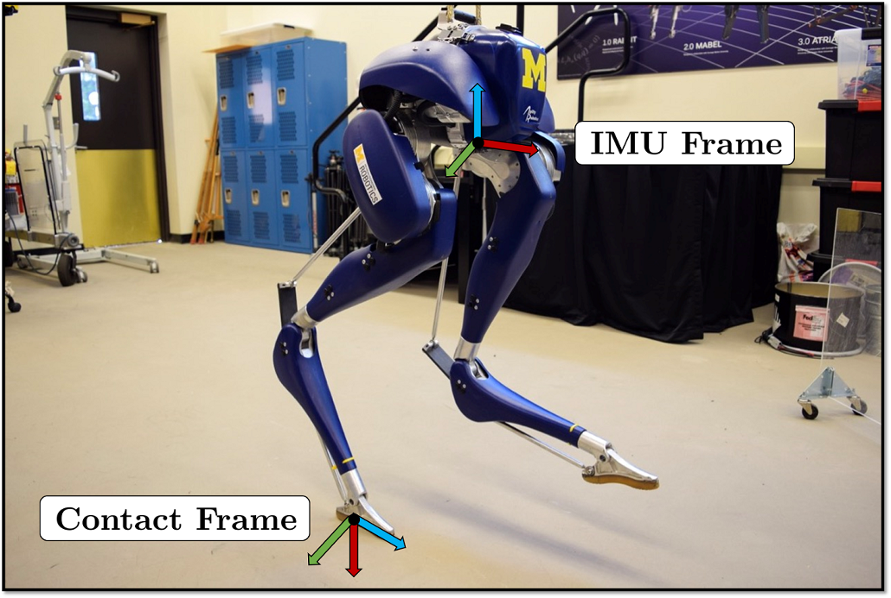

**图 1.** Cassie 系列双足机器人及其 IMU、接触坐标系。

## 5. $SE_{N+2}(3)$ 上的连续时间右不变 EKF

本文先在不含 IMU 偏置的条件下推导右不变扩展卡尔曼滤波器（RIEKF），再于第 7 节增广偏置。该滤波器适用于与静态环境有任意有限个接触点的机器人，也可用于满足相同接触假设的机械臂。

### 5.1 状态表示

状态包括 IMU（机体）在世界坐标系中的朝向 $R_{WB}$、速度 $^Wv_B$、位置 $^Wp_{WB}$，以及当前全部接触点在世界坐标系中的位置 $^Wp_{WC_i}$。这些变量组成扩展特殊欧氏群 $SE_{N+2}(3)$ 的矩阵。下文为简洁起见先推导单个接触点的情形；多个接触点的方程具有相同结构。IMU 输入由机体系角速度和线加速度构成。李代数维数随接触点数增加；群的伴随映射用于在状态各分量间传递误差。

### 5.2 连续时间系统动力学

IMU 角速度与线加速度测量分别含有零均值高斯白噪声 $w_g,w_a$。当二值接触传感器报告接触时，假设接触点相对世界静止，即测得速度为零；为容纳潜在滑移，将该速度观测建模为含白噪声的量。状态的主要连续动力学为

$$\dot R_t=R_t(\tilde\omega_t-w_{g,t})^\times,\quad
\dot v_t=R_t(\tilde a_t-w_{a,t})+g,\quad
\dot p_t=v_t,\quad
\dot d_t=R_th_R(\tilde\alpha_t)(-w_{v,t}). \tag{8}$$

其中 $h_R(\tilde\alpha_t)$ 是由关节编码器与正向运动学得到的接触坐标系相对于 IMU 的方向矩阵。将状态写成群矩阵后，确定性动力学满足群仿射条件。因此右不变误差满足自治方程；在李代数中近似写为 $\dot\xi_t=A_t\xi_t+\operatorname{Ad}_{\bar X_t}w_t$。确定性右不变误差系统的矩阵具有由重力项和速度—位置耦合项构成的稀疏结构。估计状态按确定性动力学传播，协方差按黎卡提方程 $\dot P_t=A_tP_t+P_tA_t^T+\bar Q_t$ 传播，其中噪声协方差经伴随映射变换。

### 5.3 右不变正向运动学观测模型

设 $\alpha_t$ 为机体与接触点之间的关节角，编码器读数含高斯噪声。使用正向运动学 $h_p$ 测得接触点相对机体的位置，线性化后测量噪声由正向运动学雅可比 $J_p$ 传播。将观测写成矩阵形式后，它符合右不变观测形式。用指数映射和卡尔曼增益更新状态：

$$\bar X_t^+=\exp(K_t\Pi\bar X_tY_t)\bar X_t,\qquad
P_t^+=(I-K_tH_t)P_t(I-K_tH_t)^T+K_t\bar N_tK_t^T. \tag{19}$$

其中创新协方差 $S_t=H_tP_tH_t^T+\bar N_t$、增益 $K_t=P_tH_t^TS_t^{-1}$；观测矩阵 $H_t=[0\ 0\ -I\ I]$，观测噪声协方差由 $\bar R_tJ_p\operatorname{Cov}(w_\alpha)J_p^T\bar R_t^T$ 给出。误差更新矩阵与状态估计无关。

### 5.4 可观测性分析

因为误差动力学对数线性，可直接分析其离散线性系统，而无须进行非线性可观测性分析。离散状态转移矩阵是误差动力学矩阵的指数；由观测矩阵与状态转移矩阵构成可观测性矩阵后，可以看出绝对位置不可观测。由于重力只有竖直分量，绕重力方向的偏航角同样不可观测。这与既有非线性可观测性分析一致，但计算更简单。误差线性化不依赖状态估计，也避免线性化数值秩虚假增加的问题。

## 6. 仿真结果

作者将所提滤波器与类似 Bloesch、Rotella 等人方法的四元数 EKF（QEKF）比较。二者最主要的差别在于误差变量：QEKF 将姿态、速度、位置和接触位置误差分开定义；InEKF 则采用群上的不变误差。因而，QEKF 的线性化误差动力学和观测矩阵依赖当前状态估计，而右不变 InEKF 的确定性误差动力学满足对数线性性质，观测矩阵也与估计值无关。

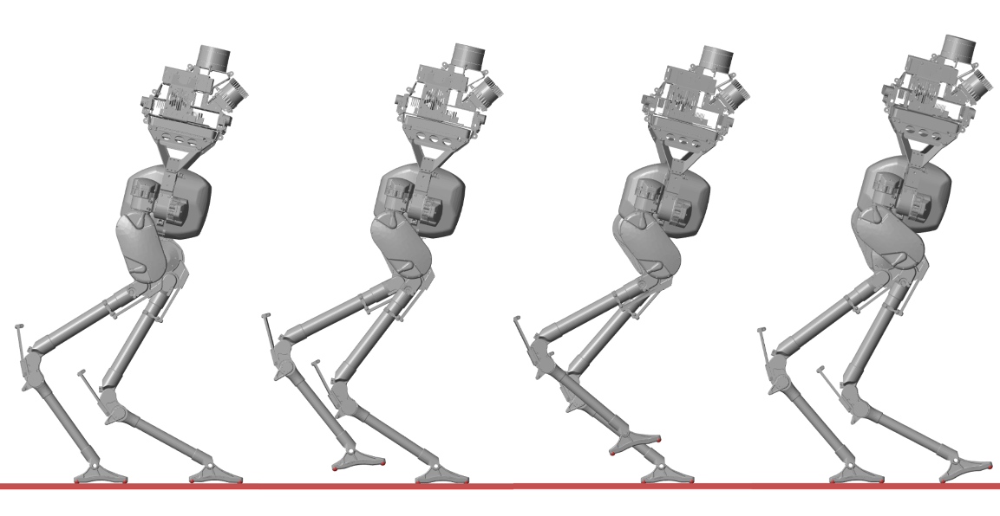

**图 2.** 用于滤波器比较的 Cassie 双足机器人典型步态仿真。

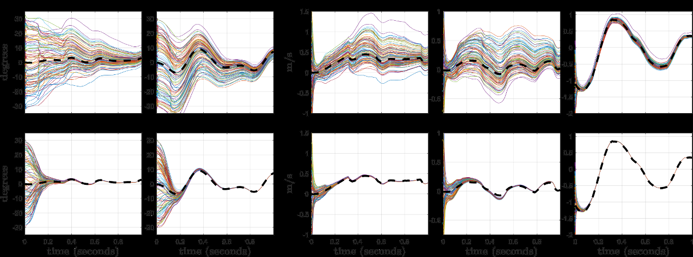

**图 3.** QEKF 与 RIEKF 在随机初始姿态、速度下的收敛比较。

### 6.1–6.2 收敛比较

作者在 Simscape Multibody 中模拟 Cassie 双足机器人从小落差后向前行走，速度从 0 增至约 0.3 m/s。测量加入加性高斯白噪声，滤波器使用相同噪声统计与初始协方差。100 次重复试验分别随机初始化姿态（欧拉角在 ±30° 内）和速度（各分量在 ±1 m/s 内）。两种滤波器均可收敛，但 RIEKF 对所有可观测状态的收敛显著更快。偏航角本身不可观测，因此不会收敛。

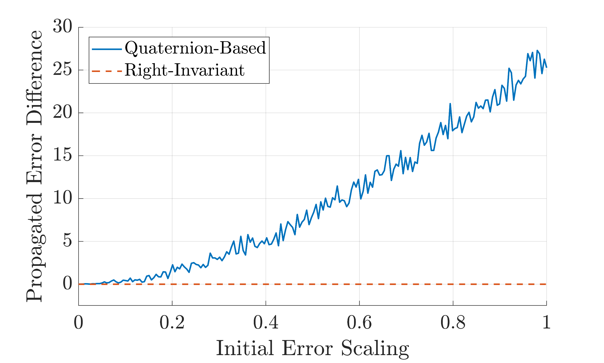

**图 4.** 确定性误差动力学的传播精度。

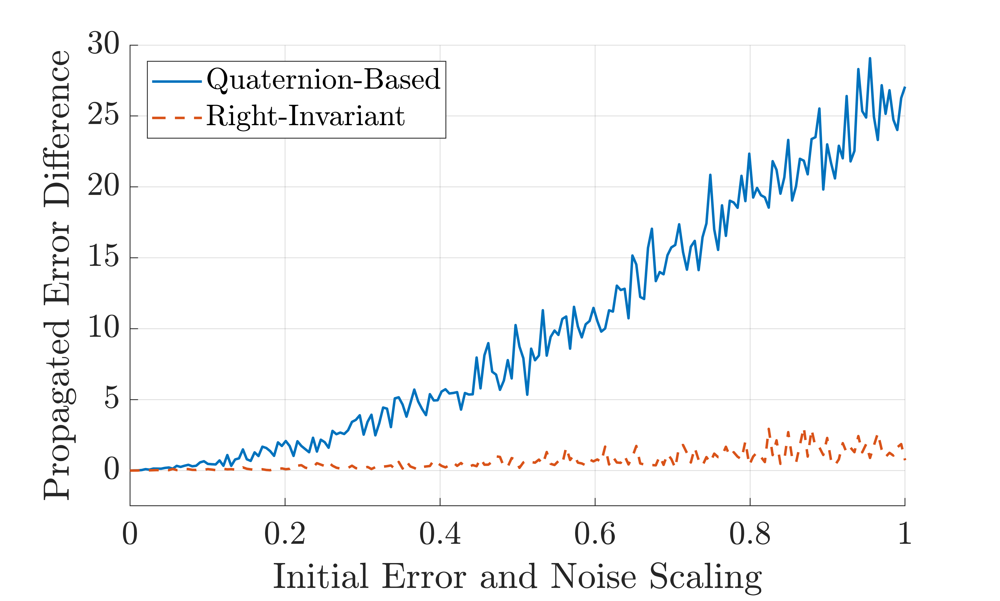

**图 5.** 测量含噪时真实误差与传播误差的差异。

### 6.3 线性化误差动力学精度

作者在确定性试验中随机采样 IMU 输入，将真实误差与各自线性误差系统传播所得误差比较，并逐步增大初始姿态误差。初始误差为零时，两种滤波器的误差传播均正确；初始误差变大后，QEKF 的传播差异随之增大，而 InEKF 的确定性误差传播仍精确。加入传感器噪声后，对数线性性质不再严格成立，但 InEKF 的线性化仍更准确，对初始误差也较不敏感。

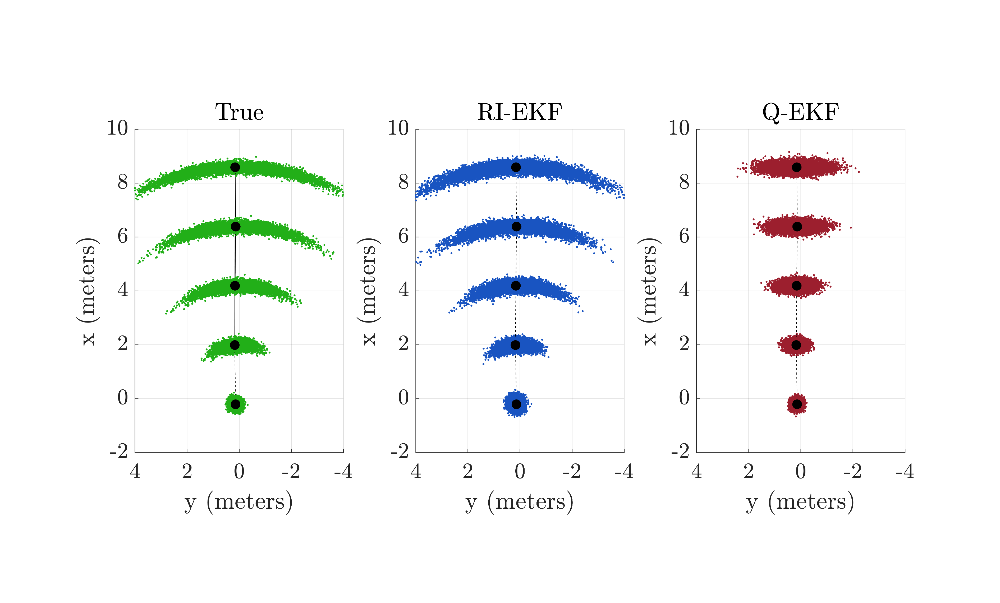

**图 6.** Cassie 行走过程中的位置不确定度样本。

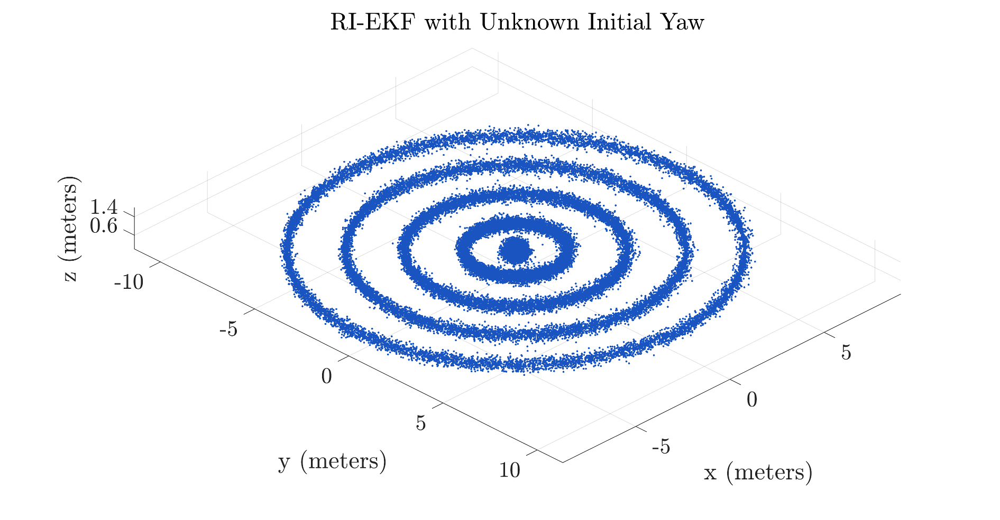

**图 7.** 初始偏航完全不确定时 InEKF 的位置分布。

### 6.4 协方差椭圆比较

QEKF 的欧氏误差高斯分布经线性加法得到椭圆形位置不确定度；InEKF 将李代数误差通过指数映射作用到群上，所得分布为李群上的集中高斯，能表达姿态与位置之间的耦合。机器人以平均 1 m/s 行走 8 秒的仿真显示，初始偏航不确定性会导致弯曲的位置分布，InEKF 能更贴近该分布，QEKF 的高斯椭圆则难以表达。将初始偏航标准差设为 360° 后，InEKF 仍能表示环状不确定度。若去除过程噪声并令部分协方差为零，滤波状态会保持在李群的时变子集内；相关理论可用于构造含状态等式约束的 EKF。

## 7. IMU 偏置增广

硬件实现通常要估计陀螺仪和加速度计偏置。不存在一个同时包含偏置且令系统满足群仿射性质的李群，因此加入偏置后，InEKF 的部分理论保证不再成立；但仍可构造“非理想 InEKF”，且其实际性能仍可能优于标准 EKF。

偏置向量为 $\theta_t=[b_{g,t}^T\ b_{a,t}^T]^T$，与原李群状态组成乘积状态。误差包括右不变群误差 $\eta_t^r$ 和欧氏偏置误差 $\zeta_t=\bar\theta_t-\theta_t$。陀螺仪及加速度计读数分别减去估计偏置后用于传播；偏置采用布朗运动模型，导数为白高斯噪声。对增广误差作一阶展开后，线性化系统矩阵会含有当前估计姿态、速度、位置和接触点位置与偏置误差之间的耦合项；测量矩阵则在原位置后附加偏置对应的零列。

最终预测步骤按偏置校正后的确定性动力学推进状态，并以增广黎卡提方程传播协方差。校正步骤仍使用指数映射更新李群状态，同时以欧氏加法更新偏置，协方差采用标准卡尔曼更新。矩阵中的偏置块将机体系偏置误差映射到世界坐标系。

## 8. 接触点的增删

机器人行走时会不断建立和解除接触。移除接触点时，从状态群中删去对应状态，并通过线性投影矩阵同步删去协方差的相应行列。新增接触点时，先用正向运动学初始化其均值：

$$\bar d_t=\bar p_t+\bar R_th_p(\tilde\alpha_t). \tag{31}$$

再由新接触点误差与机体位置误差、编码器噪声之间的线性关系扩充协方差：$P_t^{new}=F_tP_tF_t^T+G_t\operatorname{Cov}(w_\alpha)G_t^T$。左右不变误差形式下，协方差增广矩阵不同；接触点边缘化矩阵则相同。

## 9. Cassie 机器人实验

Cassie 系列双足机器人由 Agility Robotics 开发，具有 20 个自由度、10 个执行器和 4 个弹簧。机体配有 VectorNav-100 IMU 与 14 个关节编码器，IMU 以 800 Hz 输出角速度和线加速度，编码器采样率为 2000 Hz。腿部弹簧压缩量由编码器测得，可作为二值接触信号。算法及反馈控制器基于 MATLAB/Simulink Real-Time 实现。

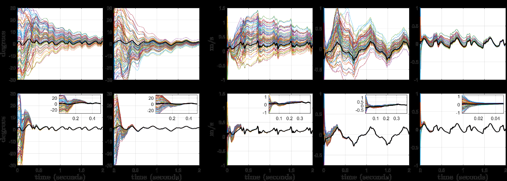

**图 8.** 真实 Cassie 机器人行走时两种滤波器的收敛比较。

### 9.1 收敛比较

机器人以约 0.3 m/s 向前行走。对同一组记录的测量离线运行 QEKF 和 RIEKF 各 100 次，使用相同噪声统计、初始协方差，并随机设置初始姿态和速度。偏置估计开启，初始偏置由机器人静止期间的 IMU 数据确定。实验显示 RIEKF 在所有可观测状态上比 QEKF 更快、更可靠地收敛。当初值已接近真实值时，两者表现相似；初值较差时，QEKF 的线性化围绕错误工作点进行，RIEKF 则对初始状态偏差较不敏感。启用偏置估计会削弱理论上的状态无关性，但实验仍支持优先采用 RIEKF。

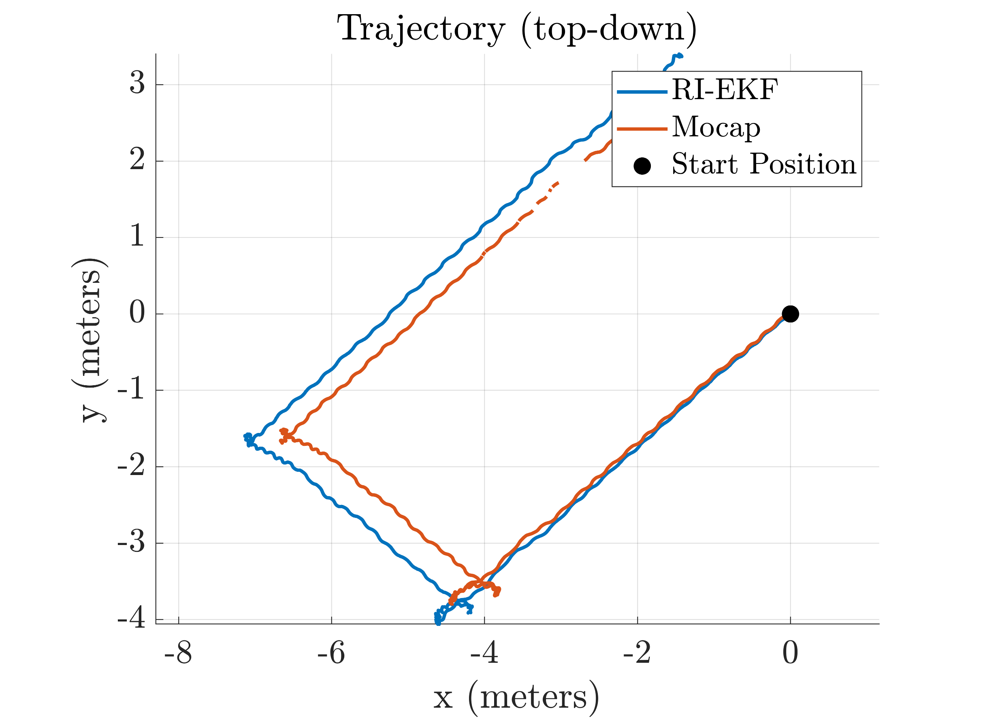

**图 9.** 运动捕捉实验的 InEKF 估计轨迹。

### 9.2 运动捕捉实验

在密歇根大学 M-Air 场地，Cassie 无线缆行走约 60 秒、路径约 15 米；场地使用 18 台 Qualisys 相机跟踪位置。最终位置漂移小于行走距离的 5%。漂移来自传感器噪声、足底滑移及运动学模型误差。可观测状态的误差保持较小；绝对位置和绕重力轴的朝向不可观测，因此会漂移。为绘制 3σ 协方差范围，作者将右不变误差协方差近似转换成欧氏姿态、速度、位置误差协方差。姿态真值使用 VectorNav-100 的 EKF 输出，位置和速度真值使用运动捕捉系统。

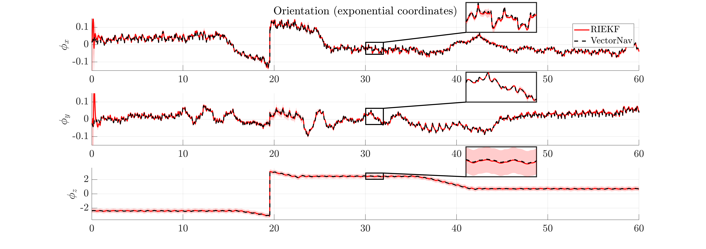

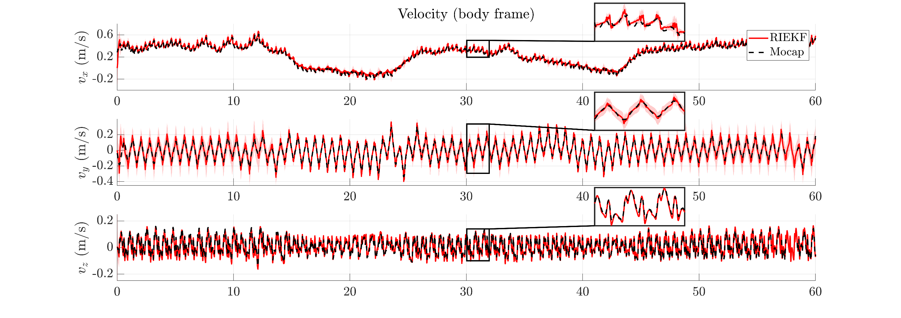

**图 10.** 运动捕捉试验中的姿态、速度、位置和协方差范围。

**图 11.** Cassie 沿人行道行走约 200 米的室外里程计轨迹。

### 9.3 长距离里程计

Cassie 沿密歇根大学 Wave Field 附近的人行道步行约 200 米，耗时 7 分 45 秒。InEKF 里程计轨迹在整个试验中保持在人行道范围内，终点位置误差仅数米，偏航漂移不明显。该里程计只依赖惯性、接触和运动学数据，不需要易受环境或光照变化影响的视觉系统。

### 9.4 激光雷达建图

作者在 Cassie 躯干安装 Velodyne VLP-32C 激光雷达，将每帧点云依据当前状态估计变换到世界坐标系并累积成环境地图。高频里程计还能对 10 Hz 激光雷达单次扫描内的机器人运动进行补偿。论文展示了校园地标、楼梯、人行道和建筑内部等场景的点云地图。

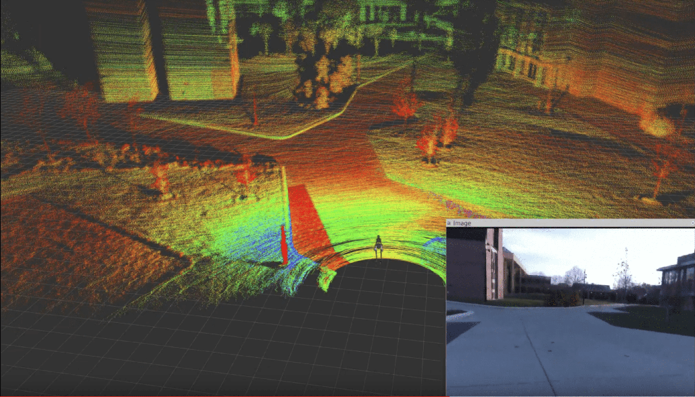

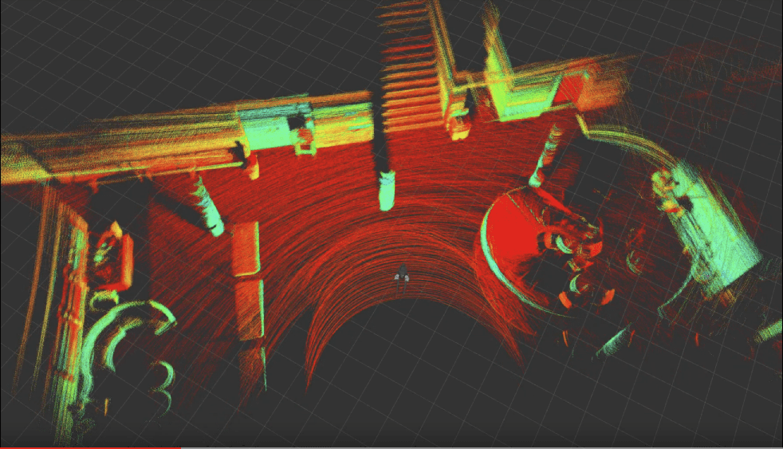

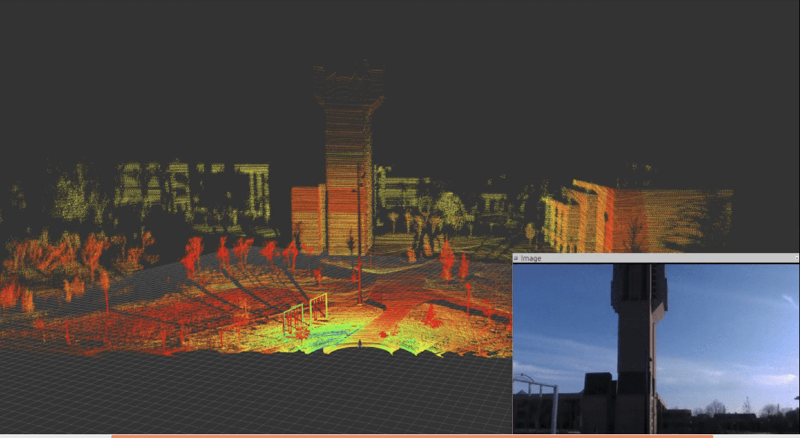

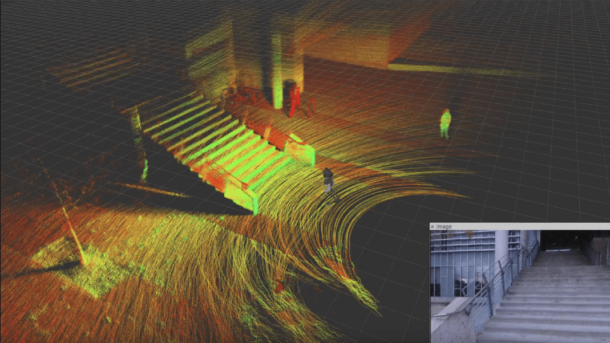

**图 12.** 基于 InEKF 位姿估计构建的 LiDAR 点云地图。

## 10. 左不变形式

前述推导使用右不变误差，因为正向运动学观测具有右不变形式。对于 GPS 等左不变观测，也可推导左不变滤波器。左不变误差写作 $\eta_t^l=X_t^{-1}\bar X_t$。一阶展开后，其线性化动力学由偏置校正后的角速度、加速度及误差分量构成；遇到左不变观测时，在状态更新中将指数映射乘于状态右侧。

### 10.1 左右不变误差转换

左右误差可通过伴随映射精确转换：

$$\xi_t^r=\operatorname{Ad}_{\bar X_t}\xi_t^l,\qquad
P_t^r=\operatorname{Ad}_{\bar X_t}P_t^l\operatorname{Ad}_{\bar X_t}^T. \tag{36}$$

因此，面对右不变观测时，可临时将左不变协方差转换为右不变形式，执行校正后再转换回来。直观上，左不变误差在机器人机体坐标系中表达，右不变误差在世界或空间坐标系中表达；观测的坐标结构决定指数映射出现在更新式的左侧还是右侧。

### 10.2 左不变形式下新增接触点

移除接触点仍采用边缘化。新增接触点的误差近似包含机体位置误差、姿态误差与正向运动学噪声：$\xi_d\approx\xi_p-(h_p(\tilde\alpha))^\times\xi_R+J_p(\tilde\alpha)w_\alpha$。据此构造状态与噪声线性映射，按协方差增广公式更新不确定度。

## 11. 机器人中心估计器

作者进一步推导以机器人基座坐标系表达状态的“机器人中心”滤波器。状态可视为世界中心状态矩阵的逆。此时，正向运动学观测成为左不变观测；左右不变误差的动力学矩阵与世界中心形式交换对应。该滤波器的性质与世界中心版本相同，但直接输出机体系速度，可能更适合腿式机器人控制。

机体系状态包含世界相对机体的朝向、负的机体系速度、世界原点在机体系中的位置，以及接触点在机体系中的位置。其偏置校正动力学仍满足群仿射性质。机体系正向运动学观测为接触点与机体间的相对位置；线性化观测矩阵与世界中心形式仅在符号和状态定义上不同。

## 12. 其他传感器观测

磁力计、加速度计、GPS、视觉惯性导航等传感器也可满足不变观测形式，InEKF 亦可用于 SLAM。接触辅助 InEKF 与基于地标的 SLAM 具有直接对应关系：接触点相当于静态地标，正向运动学测量相对位移。区别在于接触位置允许白噪声以表示足底滑移，运动学观测频率较高，而且不需要地标数据关联。状态矩阵可将接触点替换为地标，也可同时包含两者；加入地标观测后可以消除部分不可观测状态，但地标过多会增加计算量。

论文的汇总表给出了世界中心和机器人中心状态、动力学、线性化误差传播、噪声矩阵，以及正向运动学、相对/绝对地标、磁力计和 GPS 的观测矩阵。作者将这些实现发布为开源 C++ 库 `invariant-ekf`。

## 13. 结论与未来工作

本文利用群不变 EKF 理论，为三维腿式机器人推导接触辅助惯性导航观测器。现代双足机器人通常配备接触传感器和 IMU；较大的收敛域有望提升感知与控制系统的可靠性。作者将 IMU 偏置纳入状态，并指出尽管理论保证有所减弱，实测收敛性能仍优于常用 QEKF。论文还讨论左不变动力学及机器人中心滤波器。

Cassie 实验通过运动捕捉验证估计精度，通过长距离室外步行检验里程计，并展示激光雷达建图。未来工作包括构造不变平滑器，改进 IMU 和接触预积分及 SLAM；在线估计运动学参数以校正正向运动学偏置；识别站立、平地行走和转向等运动模式并利用其附加约束；进一步研究视觉—惯性—接触里程计，以及将先验地形信息纳入滤波器。

## 附录 A：滤波方程离散化

附录给出世界中心左右不变滤波器的精确离散化方法。对单个采样区间，状态由 IMU 角速度、加速度和重力的解析积分更新；旋转积分通过 $SO(3)$ 指数映射完成，速度和位置积分使用 $\Gamma_0,\Gamma_1,\Gamma_2$ 等闭式矩阵函数。协方差转移矩阵由连续误差系统矩阵指数 $\Phi(t_{k+1},t_k)=\exp(A\Delta t)$ 给出，过程噪声协方差通过区间积分计算。右不变形式的离散矩阵可由左不变转移矩阵及状态伴随映射互相转换。完整分块矩阵与积分定义见原文附录 A。

## 附录 B：李群表达式

附录列出 $SE_{N+2}(3)$ 的群元素、逆、李代数、指数映射及伴随映射。群元素由旋转矩阵和速度、位置、接触点向量列组成；指数映射中的旋转部分使用 $SO(3)$ 指数，平移相关列使用对应的雅可比矩阵函数。正文推导中使用的左右不变误差转换即由该伴随映射实现。

## 附录 C：误差状态转换

附录推导从右不变李代数误差协方差到欧氏姿态—速度—位置误差协方差的一阶变换。姿态误差通过 $SO(3)$ 左雅可比逆映射，速度和位置误差还包含姿态误差与当前估计速度、位置的叉乘耦合项。该变换用于运动捕捉实验中绘制协方差范围。

## 致谢与参考文献

作者感谢相关研究团队及实验支持。原文参考文献 [1]–[86] 保留在本项目 `source-pages/page-39.txt` 至 `page-44.txt` 及原始 PDF 中，便于按编号核对。

---

> 公式说明：PDF 文本层对若干大型分块矩阵及附录闭式积分的提取存在排版丢失。译文保留核心可辨方程、编号和结构性结论；需逐项核对完整矩阵时，请以随附原文 PDF 为准。
