# DROPO：利用离线域随机化实现仿真到现实迁移

**原文题名：** *DROPO: Sim-to-Real Transfer with Offline Domain Randomization*  
**作者：** Gabriele Tiboni、Karol Arndt、Ville Kyrki  
**版本：** arXiv:2201.08434v2（2023 年 1 月 12 日）；后发表于 *Robotics and Autonomous Systems*, 166 (2023), 104432，DOI: 10.1016/j.robot.2023.104432。  
**关键词：** 机器人学习；迁移学习；强化学习；域随机化。

> 本页按论文结构整理中文译读，保留核心方法、公式、主要实验设计和结论；附录中大批补充分布图及参考文献仍以原文 PDF 为准。

## 摘要

近年来，对动力学参数进行域随机化已成为将强化学习策略从仿真迁移到真实机器人的常用方法，但要找到合适的随机化分布并不容易。本文提出 **DROPO**（Domain Randomization Off-Policy Optimization，离线策略域随机化优化），一种用于安全仿真到现实迁移的域随机化分布估计方法。DROPO 只需要规模有限、预先采集的离线轨迹数据，并通过基于似然的方法显式建模参数不确定性，使仿真数据与真实数据相匹配。实验表明，DROPO 能够恢复仿真中使用的动力学参数分布，也能找到可补偿未建模现象的分布。作者还在两种零样本仿真到现实迁移任务中评估该方法，结果显示迁移成功，性能优于若干已有方法。

## 1. 引言

强化学习在 Atari 游戏和围棋等任务中取得了显著进展，也因此受到机器人研究者关注。然而，多数强化学习算法样本效率较低，训练时往往需要大量数据；此外，随机探索可能损坏硬件。这些因素使强化学习在机器人上的应用进展慢于其他领域。

一种有前景的方案是在模拟环境中训练智能体，再部署到真实物理系统。仿真能快速、安全地提供数据，但仿真中的物理参数存在不确定性，且可能遗漏真实系统中的现象。因此，仿真训练出的策略未必能在真实系统上奏效，这种差异通常称为“现实差距”（reality gap）。

为了提高策略的泛化能力，可以在多个环境变体上训练：改变外观、动力学参数，或同时改变二者。这种方法称为域随机化（domain randomization, DR），已在多类机器人任务中得到验证。难点在于如何选择物理参数的随机化分布：范围要足够宽，涵盖真实参数或补偿仿真遗漏的现象；同时又不能宽到让单个策略难以在所有随机环境中收敛并保持性能，尤其是在零样本迁移时。

本文提出 DROPO，用于自动推断域随机化分布。它使用基于似然的指标，将动力学参数分布拟合到离线数据上，直接提高真实数据状态转移在仿真中的出现概率。仿真器因而可被看作一个随机前向模型，其随机性来自场景物理参数的变化。与在线自适应域随机化不同，DROPO 不需要在参数优化过程中反复访问真实硬件；它采用预先采集的数据（例如人类示范），并使用概率度量来避免基于 L2 损失的优化将分布压缩成点估计。作者还发现，似然方法可以与不可微黑箱仿真器及无梯度优化结合使用。

本文贡献包括：提出基于安全采集离线数据的域随机化分布优化方法；验证其恢复真实动力学分布的能力；展示其在存在未建模现象时可训练出有效策略；并证明使用 DROPO 分布训练的强化学习策略可以直接迁移到真实系统。作者公开了可用于任意离线数据集的实现代码。

## 2. 相关工作

域随机化可用于外观、动力学或两者的变化，以训练更具泛化能力的强化学习策略。但每个参数的随机化分布通常需要在训练前指定。域随机化本质上是在最优性与鲁棒性之间权衡：范围过宽，智能体难以学习适用于所有动力学的单一策略；范围过窄，则会使模型偏向少数动力学状态，可能无法泛化到真实环境。

已有自动调整方法包括最小化仿真轨迹与真实轨迹间差异，以及直接最大化真实环境中的预期回报。不过，这些方法在优化过程中需要真实环境反馈，因而要求能够访问并谨慎监督实体系统。

DROID 提出一种离线设置：使用预先采集的目标域数据优化域随机化分布，从而减少真实交互，并降低在接触丰富任务中执行尚未收敛策略的安全风险。其数据可以来自其他策略，也可以来自人类示范。DROPO 使用相似的问题设定，但采用似然目标，并同时优化分布均值与方差。论文第 4 节对 DROPO 与 DROID 作了比较。

BayesSim 假设数据采集策略可用：它在多种动力学条件下用该策略采集仿真轨迹，训练神经网络预测动力学参数后验，再把同一策略在真实环境中的轨迹输入网络。它无需在优化期间访问硬件，但仍要求数据采集策略已知。DROPO 则通过最大似然框架，不需要知道采集策略，更适合人类示范。其他研究还通过逐步增加环境难度、增加采样环境数量，或使用可微物理仿真器来改善域随机化。

## 3. 方法

### 3.1 背景与问题定义

马尔可夫决策过程（MDP）\(M\) 由状态空间 \(S\)、动作空间 \(A\)、初始状态分布 \(p(s_0)\)、状态转移分布 \(p(s_{t+1}\mid s_t,a_t)\) 和奖励分布 \(p(r_t\mid s_t,a_t,s_{t+1})\) 描述。智能体依策略 \(\pi(a\mid s)\) 选择动作，强化学习旨在找到最大化期望累计奖励的最优策略。

设真实环境与仿真共享状态空间、动作空间、初始状态分布和奖励函数，但仿真转移还取决于动力学参数 \(\xi\)。给定真实状态—动作轨迹数据集 \(D=\{s_0,a_0,s_1,\ldots,s_T\}\)，本文要寻找参数分布 \(p^*(\xi)\)，使数据中的下一状态在仿真中出现的似然最大：

$$
p^*(\xi)=\arg\max_{p(\xi)}\;\mathbb{E}_{s_t,a_t,s_{t+1}\sim D,\,\xi\sim p(\xi)}\left[p_{\mathrm{sim}}(s_{t+1}\mid s_t,a_t,\xi)\right]. \tag{1}
$$

### 3.2 方法概览

DROPO 分为三个阶段：在真实硬件上采集数据；拟合动力学参数分布；使用拟合完成的分布训练策略。参数拟合概括如下：

1. 初始化分布参数 \(\phi=(\mu,\Sigma)\)，并收集目标域轨迹数据 \(D\)。
2. 从当前分布 \(p_\phi(\xi)\) 中采样 \(K\) 组动力学参数。
3. 对数据集中的每个状态和一段动作序列，在相应参数设置下重放仿真，得到多个下一状态样本。
4. 用这些样本估计下一状态的均值与协方差，并计算真实下一状态在该分布下的对数似然。
5. 累加各转移的对数似然，通过无梯度优化更新 \(\phi\)，直至收敛。
6. 用收敛后的域随机化分布训练策略。

**图 1.** DROPO 使用离策略数据或人类示范学习域随机化分布，再据此训练可直接迁移到真实世界的策略。  
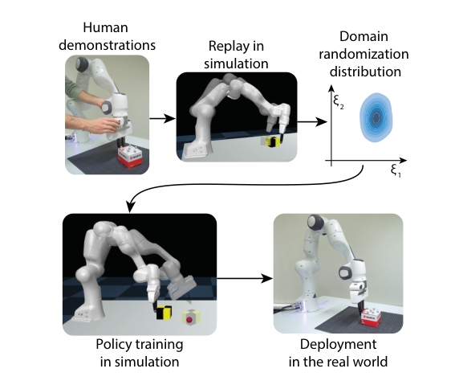

**图 2.** DROPO 的主要阶段：优化动力学参数分布，使仿真中观测到所采集数据的概率最大。  
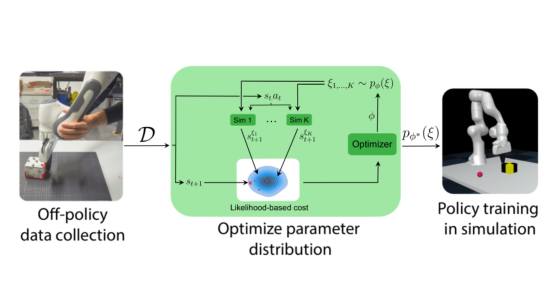

数据采集可通过执行已有策略完成，也可由人通过动觉示教引导机器人。由于 DROPO 使用离线、离策略数据，之后不必再采集数据；除最终部署外，方法其余阶段都在仿真中进行。

核心步骤是优化由 \(\phi\) 参数化的域随机化分布 \(p_\phi(\xi)\)，使真实数据的似然最大。给定 \((s_t,a_t)\)，随机化下的仿真下一状态分布为对参数边缘化后的分布：

$$
p_{\mathrm{sim}}(s_{t+1}\mid s_t,a_t,\phi)=\int p_{\mathrm{sim}}(s_{t+1}\mid s_t,a_t,\xi)p_\phi(\xi)\,d\xi.
$$

DROPO 通过从 \(p_\phi(\xi)\) 采样多组参数、重复仿真同一状态和动作，近似该积分。可将仿真推进多个时间步后再评估似然；超参数 \(\lambda\) 表示执行的连续动作数，可独立于数据采样率设置评估频率，并提高相邻状态差异的信噪比。分布收敛后，使用它在仿真中训练策略，随后部署到采集数据的系统。

### 3.3 数据采集

数据集可以来自人类示范，也可以来自安全的既有策略。采集过程必须能激发待识别参数的相关效应：例如，若示范期间物体始终不动，DROPO 就无法推断物体的摩擦系数。

示范中的真实动作有时不可直接获得，需要根据测得的状态序列通过逆动力学模型推断。在位置或速度控制的机械臂上，若假设机器人内部控制器理想，动作推断会较简单；尽管真实系统并不完全满足这一假设，实验中 DROPO 仍能处理这种偏差。

预处理时需同步不同传感器的数据，并使采样频率与仿真环境时间步一致。作者使用 Akima 样条拟合传感器测量值，再在每个环境时间步处求值；相较三次样条，Akima 插值可避免采样点之间出现过冲。

### 3.4 分布拟合

参数向量 \(\phi\) 同时包含各单变量动力学分布的均值和方差，并假设参数之间互不相关。因此，若动力学参数向量 \(\xi\in\mathbb{R}^d\)，则 \(\phi\in\mathbb{R}^{2d}\)。这不同于 DROID：DROID 只优化均值，标准差则沿用 CMA-ES 优化分布本身的结果。显式学习参数变化程度，可以更好地解释异方差和真实数据中的不确定性。作者将 DROPO 视为一种随机系数统计模型：被优化的系数本身也是随机变量，而非固定效应回归中的常量。

初始化分布 \(\phi_{\mathrm{init}}=(\mu_{\mathrm{init}},\Sigma_{\mathrm{init}})\) 可根据仿真重放轨迹粗略设定。随后从分布中采样参数，在每个真实状态处重置仿真状态，重放真实动作序列，估计下一状态高斯分布的均值和协方差：

$$
\bar{s}^{\phi}_{t+\lambda}=\frac{1}{K}\sum_k s^{\xi_k}_{t+\lambda},\qquad
\Sigma^{\phi}_{t+\lambda}=\widehat{\mathrm{Cov}}\!\left(p_{\mathrm{sim}}(s^{\mathrm{sim}}_{t+\lambda}\mid s_t,a_{t:t+\lambda-1},\phi)\right)+\mathrm{diag}(\epsilon). \tag{2}
$$

其中，\(\widehat{\mathrm{Cov}}\) 是无偏样本协方差估计，\(\epsilon\) 用于补偿观测噪声，并在协方差矩阵奇异时稳定似然计算。例如，仿真动力学无法解释的状态空间方向可能导致奇异协方差。调节 \(\epsilon\) 实际上是在控制由动力学参数变化解释的下一状态方差与由观测噪声解释的方差之间的分配。

若 \(\epsilon\) 过小，DROPO 会尝试通过扩大动力学随机性解释所有单次仿真无法复现的现象，可能对噪声或未建模效应过拟合；若 \(\epsilon\) 过大，未解释的变化会被归入观测噪声，造成过度正则化，使参数分布退化为点估计。作者建议逐步增大 \(\epsilon\)，直到真实轨迹与仿真轨迹间的均方误差（MSE）不再明显下降，类似机器学习中的“肘部法”。

作者假设真实下一状态来自仿真所诱导的下一状态高斯分布。忽略常数项，其对数似然对应的负对数似然目标为：

$$
L_t=\frac{1}{2}\left(\log\det\Sigma^{\phi}_{t+\lambda}+(\bar{s}^{\phi}_{t+\lambda}-s_{t+\lambda})^\top(\Sigma^{\phi}_{t+\lambda})^{-1}(\bar{s}^{\phi}_{t+\lambda}-s_{t+\lambda})\right). \tag{3}
$$

将各个转移的项求和得到数据集目标 \(L=\sum_t L_t\)，并更新 \(\phi\) 以最大化似然（等价于最小化上述负对数似然形式）。由于不假设仿真器可微，作者采用无梯度优化；实验中用 CMA-ES，并将均值参数线性归一化、方差参数按对数尺度归一化到 \([0,4]\)。参数分布采用互不相关的截断正态分布，限制在均值两倍标准差范围内；若采样到不可行参数（如负质量），则重新采样。

### 3.5 策略训练

收敛后的 \(p_{\phi^*}(\xi)\) 用于在仿真中训练目标任务策略。每个训练回合开始时采样新的动力学参数。强化学习算法可以任意选择；论文实验采用近端策略优化（PPO）和软演员—评论家（SAC）。离线示范数据不参与策略训练，因此只要数据能够激发与任务相关的动力学参数，就不必专门针对目标任务采集。

## 4. 实验

实验回答四个问题：DROPO 能否恢复仿真中的原始动力学参数与分布；能否在仿真存在未建模现象时训练并迁移策略；\(\epsilon\) 如何影响分布；以及相较 DROID、BayesSim 和均匀域随机化（UDR），DROPO 在真实系统上的表现如何。

### 4.1 基线方法

UDR 基线按先前研究的做法评估：在表格给出的搜索空间中随机抽取 10 组均匀随机化范围，各训练一个策略，并比较其平均表现，以体现人工选择合理范围的影响。DROID 基线改用原始状态向量而非力矩测量，因为推箱和滑冰球任务中的关节力矩无法充分描述被操纵物体的状态。DROPO 与 DROID 使用 Nevergrad 中的 CMA-ES 实现。

为使 BayesSim 适用于人类示范的离线设置，作者在数据采集期间重复原始动作序列；除这项改动外，使用其公开实现。多数实验报告神经网络特征（MDNN）与准随机傅里叶特征（MDRFF）中表现较好的结果。BayesSim 输出混合高斯分布，因此文中表格和图中的结果以独立高斯近似表示，完整后验见附录 D。

### 4.2 Hopper 仿真环境

Hopper 是一个单腿机器人，目标是尽可能快速向前跳跃且不摔倒。作者通过改变各连杆质量引入动力学随机化，以测试 DROPO 的参数识别能力。随后还通过给躯干质量指定错误值，构造仿真中未建模的效应。离线轨迹来自在目标环境中训练的半收敛策略。

#### 4.2.1 点动力学系统辨识

当离线数据只来自一个 Hopper 动力学实例时，DROPO 应识别其物理参数，并收敛到近似点估计。作者在真值动力学下采集两条轨迹，共 1000 次状态转移（约 8 秒），并分别测试无噪声数据和加入方差 \(10^{-5}\) 噪声的数据。两种情形下，DROPO 都收敛到原始动力学；学得参数的标准差降至优化下界 \(10^{-5}\)。

DROID 也能收敛到真值参数，其标准差比 DROPO 更低，因为 CMA-ES 未对方差设下界。两种方法在该点估计基准上表现接近。BayesSim 则高估分布方差，且未能准确恢复均值，与其原始论文中后验分布比数据生成时的真值宽得多的现象一致。因此，纯系统辨识能力上，BayesSim 不及 DROPO 和 DROID。

#### 4.2.2 恢复动力学分布

作者按某个已知真值分布随机改变 Hopper 各连杆质量，每 25 次状态转移重新采样；躯干质量保持固定。采集两条轨迹后，测试方法能否恢复该分布。由于 BayesSim 假设输入来自单一动力学设置，作者对不同动力学条件分别运行 BayesSim，再对输出边缘化。

结果显示，DROPO 能恢复随机化质量的原始方差及均值。DROID 的基于 L2 的目标倾向于得到点估计，难以保留随机参数的方差；BayesSim 虽保留一定方差，但分布估计不够准确。加入噪声的数据也呈现相似趋势。

**图 3.** Hopper 参数分布恢复结果。蓝色阴影表示用于采集离线数据的真实分布；图中以均值为中心展示宽度为 \(2\sigma\) 的区间。  
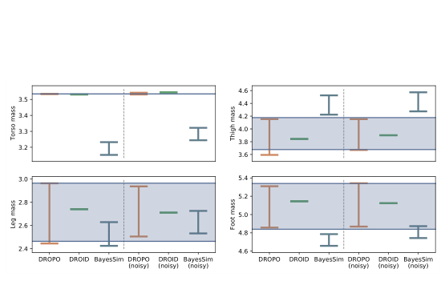

**表 1（关键结果摘录）：Hopper 点动力学与未建模效应下的质量估计。** 点动力学真值（躯干、大腿、小腿、足部，单位 kg）为 3.534、3.927、2.714、5.089。无噪声时，DROPO（ε=10⁻⁸）和 DROID 的均值均恢复真值；DROPO 标准差约为 10⁻⁵，DROID 约为 10⁻¹²。加入方差 10⁻⁵ 的观测噪声后，DROPO（ε=10⁻⁵）的均值仍约为 3.531、3.931、2.717、5.093，标准差为 8.1×10⁻³、1.3×10⁻³、1.3×10⁻³、2.4×10⁻⁴。未建模躯干质量实验中，该质量被固定为错误值 2.534 kg；DROPO 对其余三项质量得到非零方差，而 DROID 的标准差仅约 10⁻⁶。

#### 4.2.3 未建模现象

作者将源仿真器中的 Hopper 躯干质量设错 1 kg，并将其排除在待优化参数之外。各方法只能调整其余三个质量，以匹配目标轨迹。由于不存在可直接对照的真值参数分布，作者使用估计出的分布训练策略，再将策略放到原始目标环境中评估；每种方法使用不同随机种子重复三次，策略采用 SAC。

DROPO 训练出的策略优于各基线，表现接近在真值环境中直接训练的上限。DROID 和 BayesSim 的策略表现较差。部分 UDR 策略也能泛化，说明人工试错可能找到合适范围，但稳定迁移仍需要分布估计。

尽管采集数据来自点动力学，存在未建模效应时，DROPO 会对其余三个质量学出非零方差：单一参数点无法复现所有目标转移，因此优化会扩大分布来提高观测数据的似然。相比之下，DROID 会为了降低 L2 距离而趋向点估计；这种策略在训练环境中表现良好，却不能泛化到测试条件。BayesSim 得到均值接近搜索空间中心、标准差较大的分布，能覆盖未建模环境，但过大的方差使策略较保守、前进速度较慢。作者认为，未建模现象导致评估数据偏离 BayesSim 网络的仿真训练分布，从而影响泛化。

**图 4.** 在躯干质量设定错误的训练环境中学习，再在目标 Hopper 环境中测试的回报比较。  
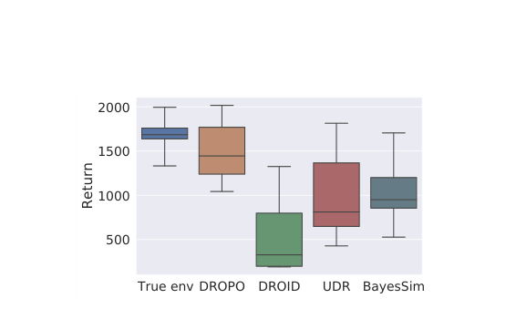

#### 4.2.4 域方差与观测噪声的权衡

\(\epsilon\) 有助于稳定含噪或有未建模效应时的似然优化，但过大时会使动力学分布退化成点估计。点动力学恢复实验显示：\(\epsilon\) 较小时，DROPO 会把观测噪声解释为动力学方差；当 \(\epsilon\) 达到或超过噪声方差时，学得标准差变得很小，MSE 显著下降。MSE 按收敛分布下仿真均值与真实下一状态的平方误差求和计算，可作为调节 \(\epsilon\) 的参考。

分布恢复实验也呈现相同规律：较小的 \(\epsilon\) 在含噪数据下导致质量方差估计过大；随着 \(\epsilon\) 增大，更多状态变化被归入噪声，分布趋向点动力学。\(\epsilon\) 接近真实噪声方差时，恢复分布最准确，同时 MSE 出现明显下降。对未建模现象实验，作者根据 MSE 曲线选取 \(\epsilon=10^{-3}\)，此处 MSE 后续不再显著改善，而参数分布又没有因正则化过强而坍缩。给病态协方差矩阵对角线加入 \(\epsilon\)，也能提高其特征值并稳定似然计算。

**图 5–7.** \(\epsilon\) 对点动力学恢复、分布恢复和未建模效应实验的影响。  
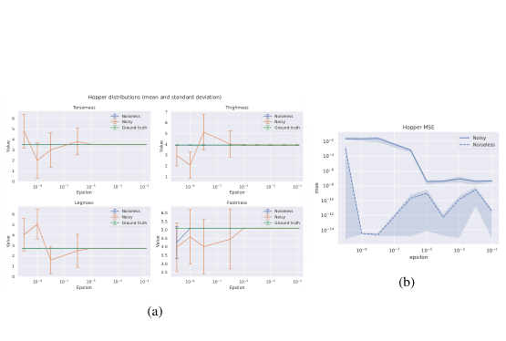  
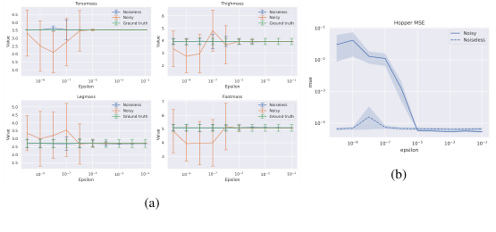  
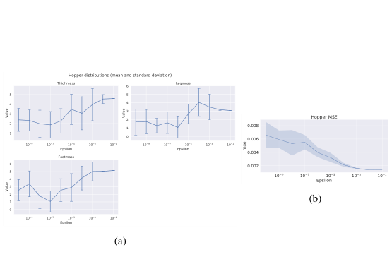

### 4.3 机器人实验

作者还在两个仿真到现实任务上评估 DROPO：冰球在低摩擦表面滑动，以及 Franka Panda 机械臂推箱。

#### 4.3.1 冰球滑动

任务是使用装有冰球杆的 Kuka LWR4+ 机械臂击打冰球，使其停在给定目标位置。真实场地使用白板作为低摩擦表面，仿真基于 MuJoCo 搭建。策略动作是一整段击球轨迹：作者先用任务轨迹训练变分自编码器（VAE），再把解码器作为轨迹生成器，以潜变量动作将强化学习任务简化为上下文多臂老虎机问题。

用于分布拟合的数据由 5 条随机轨迹组成，每条 750 次转移（7.5 秒），轨迹潜变量从标准正态分布采样。机械臂关节位置来自内部传感器，冰球位置由 120 Hz OptiTrack 动作捕捉系统测得。数据经过同步和重采样，速度由插值样条的导数得到。状态包含机械臂关节与冰球的位置、速度；由于使用轨迹生成器，重放时可直接使用原始指令速度，无需从示范中反推动作。

随机化的 18 个参数包括冰球质量、冰球与表面的摩擦系数、球杆与冰球接触的时间常数（调节刚度和阻尼并保持临界阻尼），以及仿真位置控制器增益。奖励函数为

$$r=-d^2-\log(d+\alpha),\qquad \alpha=10^{-3},$$

其中 \(d\) 是冰球到目标点的距离。DROPO 与 DROID 均明显优于 UDR，二者差异不显著，尽管 DROID 基本收敛到点估计。作者将其归因于该任务的前馈性质：轨迹选定后，智能体无法根据环境反馈调整动作，因此非退化动力学分布的收益有限。这与序贯决策任务不同，后者需要策略能从多种状态转移偏差中恢复。

**图 8–10.** Panda 推箱的仿真回报，以及冰球滑动的仿真/实物装置和实机迁移误差。  
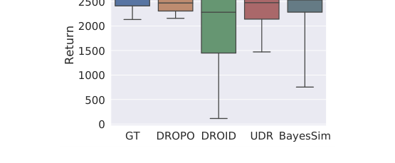  
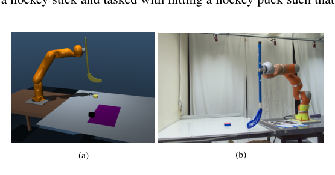  
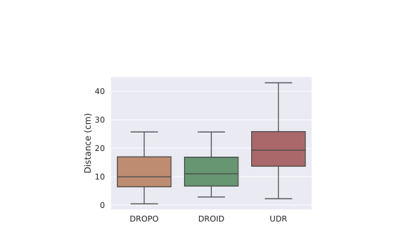

#冰球任务的表 2 显示，DROPO 估计的冰球质量、两个方向的摩擦系数和接触时间常数均值分别为 0.111、0.349、0.231、0.019；对应标准差为 2.2×10⁻⁴、3.4×10⁻⁵、4.7×10⁻⁴、6.7×10⁻⁵。DROID 的均值分别为 0.100、0.334、0.226、0.019，标准差约为 10⁻⁵ 至 10⁻⁷，进一步体现其趋向点估计。

### 4.3.2 推箱

在 Franka Panda 推箱任务中，机器人要把盒子推到目标位置。作者在盒子一侧放置钢螺栓、另一侧填充气泡膜，使质心偏离几何中心。随机化参数包括盒子质量、盒子与桌面沿两个轴的摩擦系数，以及质心偏移 \((com_x,com_y)\)；状态中额外加入盒子朝向和角速度。

为建模朝向的似然，作者使用四元数表示姿态，并计算真实数据与仿真结果间的角度差 \(\alpha\)。在状态向量中，以该角差替代仿真朝向，并将真实朝向差设为零。由于角度分布不适合用单个高斯表示，每次转移同时加入 \(\alpha\) 和 \(-\alpha\) 两个样本，使分布关于零对称。

在仿真到仿真测试中，作者使用一个向前推箱策略收集 50 条轨迹，每条 30 次转移；每次完整轨迹后从真值分布重新采样动力学参数。DROPO 的结果接近真值分布，但并不完全一致；DROID 收敛到点估计。沿 x 轴的摩擦最难识别，因为示范主要沿 y 轴把箱子推离机器人，该方向的摩擦变化对运动影响较小，也可能被其他参数变化解释。盒子质量同样不易辨识，因为推断时使用位置控制器，且盒子比机械臂轻得多。

随后，各方法用所得分布训练策略，将箱子推向机器人左前方的目标位置。奖励沿用冰球任务，并加入控制惩罚，避免机械臂超过实体硬件的速度与加速度限制。DROPO 的策略接近真值策略，DROID 较差；UDR 也优于 DROID，说明该任务中较宽但不够精确的动力学分布，有时比收敛的点估计更利于迁移。

仿真推箱的表 3 中，真值均值（质量、x/y 摩擦、x/y 质心偏移）为 (0.7, 0.8, 0.8, 0.01, 0.01)，标准差为 (0.3, 0.2, 0.2, 0.001, 0.001)。DROPO 估计均值为 (0.788, 0.603, 0.683, 0.015, 0.009)，标准差为 (0.108, 0.033, 0.18, 0.001, 0.003)；DROID 的五项标准差均约为 10⁻¹⁰ 至 10⁻¹¹。表 4 的实机数据拟合中，DROPO 估计均值为 (1.065, 0.387, 0.921, 0.012, −0.032)，标准差为 (1.3×10⁻⁴, 3.0×10⁻³, 5.3×10⁻⁴, 5.2×10⁻⁵, 7.5×10⁻⁴)。BayesSim-MDNN 的质心均值为 (−0.322, −0.240) m，质心不确定性较大；MDRFF 得到更合理的均值，但质心标准差仍约为 0.075–0.090 m。

实机实验中，作者通过动觉引导采集一条约 13 秒、与任务无关的轨迹；关节位置由编码器获取，物体运动由 OptiTrack 跟踪。DROPO、DROID、BayesSim 和 UDR 的策略均在实机上评估，每个策略每个随机种子运行 5 次。DROPO 表现最好，能把箱子推到距目标约 2 cm 的位置，完成零样本迁移。BayesSim 的表现波动较大，平均结果与 DROID、UDR 接近。神经网络特征版本预测的质心偏移超过 20 cm，标准差超过 50 cm，明显落在箱体外；仿真器将这些值裁剪到可行范围后仍可训练策略。作者推测这是由于真实轨迹落在 BayesSim 仿真训练分布之外。MDRFF 特征的预测更合理，但仍有超过 7 cm 的过大标准差，且部分抽样质量为负。

**图 11.** 推箱任务的仿真环境、真实环境与盒子内部配重。  
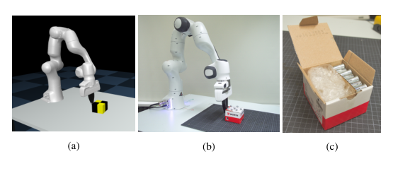

**图 12.** 推箱实机测试的目标位置误差，距离越小越好。  
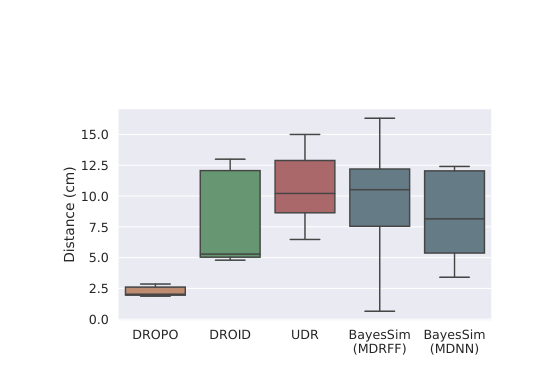

### 5. 结论

本文提出 DROPO，利用规模有限的离线数据优化域随机化分布，以缩小现实差距。实验显示，DROPO 能恢复仿真数据生成时使用的动力学参数分布，也能通过调整其他参数分布来补偿错误设定的物理参数。冰球滑动与推箱实验进一步表明，使用 DROPO 分布训练的策略可直接迁移到真实系统；在推箱任务中，已有方法未能达到相同表现。作者认为，DROPO 能同时进行系统辨识和域随机化，并通过 \(\epsilon\) 平衡参数不确定性。

本文使用了多种离线数据采集方式：Hopper 的部分训练策略、冰球任务的随机滑动轨迹，以及推箱任务的人类动觉示范。未来可研究数据采集策略如何影响离线方法对参数的估计准确性，并结合元学习中的探索策略。

当前 DROPO 受限于相对低维的参数分布；不可微优化成本较高，也限制了可处理的参数维度。作者建议研究更灵活的采样方法（例如 Stein 变分梯度下降），并将似然计算扩展到高维状态，如视觉策略和离线图像。该思路还可用于调整视觉域随机化，例如程序化纹理生成参数。

域随机化还要求用户选择哪些参数应当随机化。本文依赖领域知识手动选择；在专业知识有限的场景中，这可能很困难。尽可能多地随机化会增加计算成本，也可能生成物理上不可行的参数组合并造成仿真不稳定。此外，仿真到现实迁移通常需要精确物理引擎、物体网格和参数化模型，建模工作量较大。未来若能从真实系统外观自动构建形状和运动学结构，再利用预采集物理观测通过 DROPO 调节动力学参数，将有助于工业数字孪生等应用。

## 致谢

本研究得到芬兰科学院项目 317020 和 328399 资助。作者感谢 CSC – IT Center for Science（芬兰）及 Aalto Science-IT 项目提供计算资源。

## 附录译读

### 附录 A：离线域随机化优化中的最小二乘

作者解释 DROID 一类最小二乘轨迹对齐方法为何容易收敛到点估计。设确定性仿真动力学为 \(f(s_i,a_i;\xi)\)，典型平方误差目标为

$$J(\xi)=\frac{1}{K}\sum_{i=1}^{K}\|f(s_i,a_i;\xi)-s_{i+1}\|^2. \tag{A.1}$$

若优化的目标是参数分布下 \(J(\xi)\) 的期望，那么该期望不可能小于搜索区域内的全局最小值 \(j_{\min}\)：令 \(Y=J(\xi)-j_{\min}\ge0\)，则

$$\mathbb{E}[Y]=\mathbb{E}[J(\xi)-j_{\min}]\ge0,\qquad \mathbb{E}[J(\xi)]\ge j_{\min}. \tag{A.2–A.3}$$

因此，除非添加鼓励方差的约束或改用概率度量，否则优化期望平方误差并不会因保留分布方差而获益；理想优化器会把概率质量集中在最小点上。作者指出，这一推理不适用于原始在线 SimOpt：其目标是让在分布上训练出的策略在真实系统中表现一致，策略训练与真实交互反馈仍在环路中。

### 附录 B：\(\epsilon\) 的影响

对不同噪声水平下的 Hopper 数据进行补充分析后，作者发现，\(\epsilon\) 接近观测噪声方差时，MSE 通常明显下降；点估计均值较稳定，标准差也较低。分布恢复实验同样显示，当 \(\epsilon\) 与噪声方差匹配且没有过大时，估计方差最接近真值。附录图 B.13、B.14 展示了完整敏感性曲线。

### 附录 C：数据量敏感性

作者从 Hopper 点动力学数据中抽取 10、30、100、300、1000 和 3000 次状态转移，并在不同噪声水平下估计动力学分布均值，\(\epsilon\) 固定为 \(10^{-5}\)。当噪声方差约为 \(10^{-8}\) 或更低时，10 次转移已足以使估计接近真值；噪声更大时，需要数百次转移。各实验所用数据均在一分钟以内采集：Hopper 为 1000 次转移、8 秒；冰球任务为 3750 次、37.5 秒；仿真推箱为 1500 次、30 秒；实机推箱为 1286 次、12.86 秒。

### 附录 D：BayesSim 完整结果

正文为了便于比较，将 BayesSim 的混合多元高斯输出简化为独立高斯近似。附录提供完整混合分布的直方图和参数两两联合分布。Hopper 的分布恢复结果通常近似单峰高斯，但独立训练运行间存在明显差异；未建模现象测试数据偏离训练域时，网络给出位于搜索区间中心附近、方差很大的分布。Panda 仿真数据中，多个训练种子大体认为质心沿 x、y 方向正向偏移，但物体质量难以识别。真实数据下 MDNN 结果出现极大方差和不可行参数；MDRFF 泛化稍好，但仍存在过大方差和负质量预测。完整图 D.16–D.21 请参阅原文 PDF。

## 参考文献

参考文献 [1]–[40] 保留原文英文书目信息及编号，见原文 PDF 第 11–12 页。
