# 通过强化学习与新型全身控制器实现鲁棒动态行走

**Donghyun Kim、Jaemin Lee、Luis Sentis**  
arXiv:1708.02205v1，2017 年 8 月

## 摘要

本文提出一种鲁棒动态行走控制器，由动态步行规划器、强化学习鲁棒化过程和新型全身运动控制器（WBLC）组成。以往方法通常只指定落脚位置或步态时序中的一项；本文规划器同时计算二者。作者设计基于相空间规划（PSP）和线性倒立摆模型的强化学习策略，使多步步态生成问题更易处理且计算快速。训练所得策略向 WBLC 提供目标指令，WBLC 再计算全尺寸人形机器人所需关节力矩。WBLC 组合多级优先任务，并在实际不等式约束下求解接触反力；新形式还通过李群算子和操作空间动力学高效计算多种雅可比矩阵的时间导数。将 RL-PSP 与 WBLC 结合后，系统能在行走中转向，并抵抗最高 520 N、持续 0.1 秒的推力。理论与数值验证在 Valkyrie 人形机器人三维物理仿真中完成。

**关键词：** 双足行走；强化学习；全身控制。

## I. 引言

本文研究全尺寸双足人形机器人的鲁棒动态行走，将强化学习（RL）与新的全身阻抗/力控制器结合。传统步行规划通常指定落脚位置和步态时序，随后通过在线优化求轨迹；当两者同时变化时，动力学呈非线性，实时优化开销较大。本文改为离线学习策略，在运行时快速生成许多步的规划结果。

仅有鲁棒步行规划器还不足以直接驱动完整人形机器人。为此作者提出全身步行控制器 WBLC，在保持优先任务控制能力的同时，结合投影式层级控制与带不等式接触约束的二次规划（QP）。投影式方法计算较快，却难以处理单边接触和摩擦锥；QP 便于处理不等式约束，但计算成本较高。WBLC 将 QP 限制在接触反力变量上，再使用投影算子处理关节加速度任务，以兼顾效率与约束表达。

作者还将质心角动量（CAM）纳入任务层级。快速摆动躯干时，若要求角动量任务与姿态任务处于同一优先级，手臂可能出现不需要的补偿动作；通过将手臂姿态置于 CAM 之前，可以调整全身动作以优先满足躯干姿态。本文主要贡献包括：以 RL 学习抗推扰步态及落脚位置/时序；扩展 PSP 使机器人能向任意方向转向；提出结合 QP 接触力约束与投影式优先级控制的 WBLC；在 Valkyrie 仿真中验证动态转向和大推力恢复。

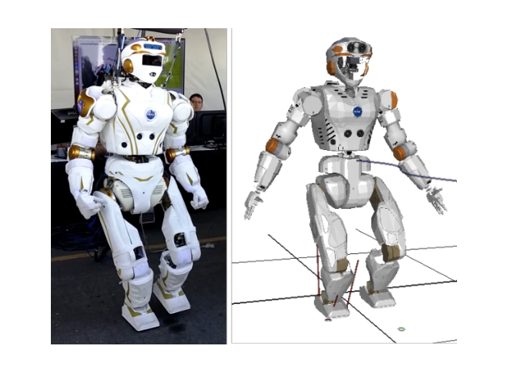

**图 1.** 左：NASA Valkyrie 人形机器人；右：SrLib 中的物理仿真模型。

## II. 基于强化学习的相空间规划器

作者围绕 PSP 构造 RL 过程。PSP 使用棱柱倒立摆模型（PIPM）生成有效步态切换信息，充分利用步态在简化相空间中的结构。质心（CoM）高度采用分段线性表面，因此可解析求解步态切换，而无需数值积分和二分搜索。矢状面步态轨迹由连续抛物线段构成；额状面轨迹形成半周期闭合循环。下文用 $x$ 表示矢状方向、$y$ 表示额状方向。

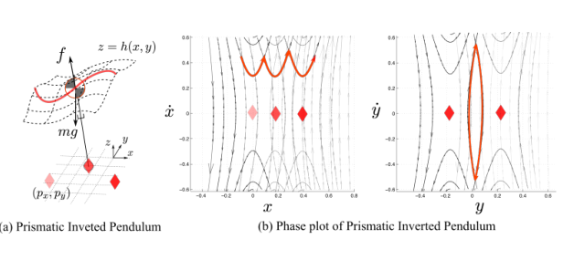

**图 2.** 可变高度表面上的 PIPM 三维位置及动态行走期间的多步质心相图。

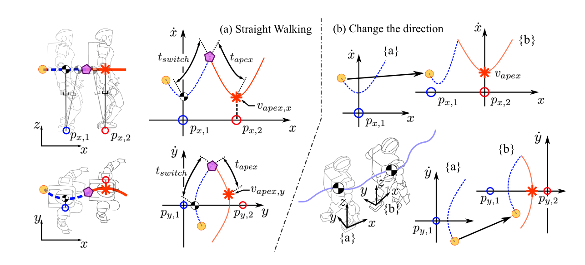

**图 3.** PSP 根据前向落脚位置和顶点速度计算切换时刻、侧向落脚位置；转向时将局部坐标系对准目标方向。

### A. 相空间规划

与根据脚步位置和时序求质心轨迹的方法不同，PSP 根据矢状向脚步位置和期望顶点速度，求步态切换时刻与侧向脚步位置。顶点状态是矢状向质心速度达到极小值时的状态，也可视为质心位于支撑脚局部坐标原点正上方的状态。状态取为

$$s=[y_{apex},\dot x_{apex},\dot y_{apex}]^T,$$

动作取为

$$a=[p_x,\dot x_{apex},\dot y_{apex}]^T.$$

给定当前顶点状态和动作，转换函数先通过 PSP 求切换时刻、顶点时刻和脚步位置，再用线性倒立摆模型（LIPM）的解析解计算下一顶点状态与即时奖励。转向时，先将下一局部坐标系的朝向对准期望行走方向，再把当前质心状态投影到该局部坐标系，借此扩展传统 PSP，使机器人可动态改变行走方向。

PIPM 状态的训练范围为：$y_{apex}\in[-0.14,0.2]$ m，$\dot x_{apex}\in[0.03,0.61]$ m/s，$\dot y_{apex}\in[-0.55,0.55]$ m/s。动作范围为 $p_x\in[0.1,0.5]$ m，$\dot x_{apex}\in[0.03,0.37]$ m/s，$\dot y_{apex}\in[-0.25,0.25]$ m/s。

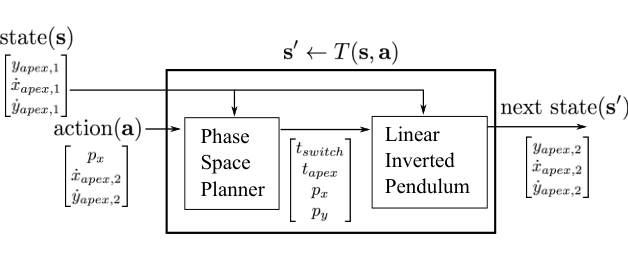

**图 4.** 转换函数先用 PSP 求时序和落脚位置，再用 LIPM 解析解得到下一顶点状态。

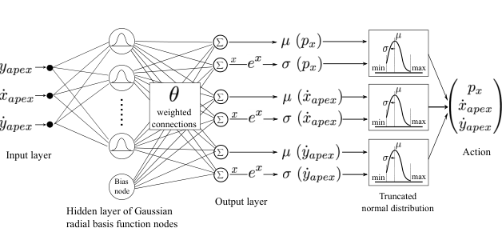

**图 5.** RBF 网络输出动作截断正态分布的均值与标准差。

### B. 强化学习问题

策略采用带资格迹的 Actor-Critic。价值函数和策略均由径向基函数（RBF）网络表示；价值网络输入为三维质心顶点状态，隐藏层包含网格化高斯基函数。策略网络为每个动作输出截断正态分布的均值和标准差，再从中采样动作。即时奖励惩罚前向顶点速度偏离目标、侧向落脚步长偏差以及非期望侧向速度：

$$R=-(\dot x^{nom}_{apex}-\dot x_{apex})^2-15(p_y^{nom}-p_y)^2-(\dot y_{apex})^2. \tag{3}$$

目标前进速度为 0.2 m/s，侧向步幅目标为 0.3 m。若下一顶点状态违反安全条件，给予 −5 惩罚并结束该回合。安全条件包括顶点和切换时间均大于 0.12 s，侧向落脚位置在 0.1–0.5 m 范围内，且状态位于允许范围。策略方差低于 0.07 时停止学习。通常约需 30,000 次迭代，在双核 3.0 GHz Intel i7 上约一分钟完成。

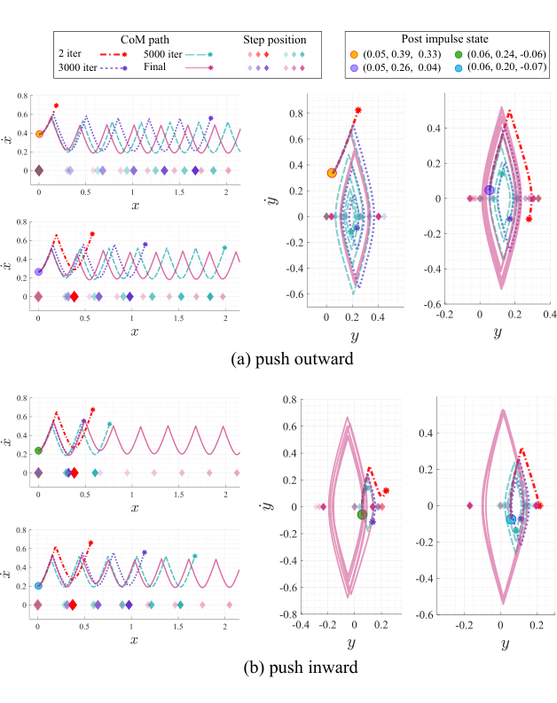

**图 6.** 随策略迭代改进，从初始推扰状态恢复并连续行走。

### C. 学习策略评估

随着迭代次数增加，策略逐渐能从多种方向的质心推扰状态中恢复。初期策略会产生无法继续的步态；最终策略能在这些初始扰动下持续行走而不摔倒。作者选取典型顶点状态 $[0.056,0.2,0]^T$，用策略均值执行恢复动作。

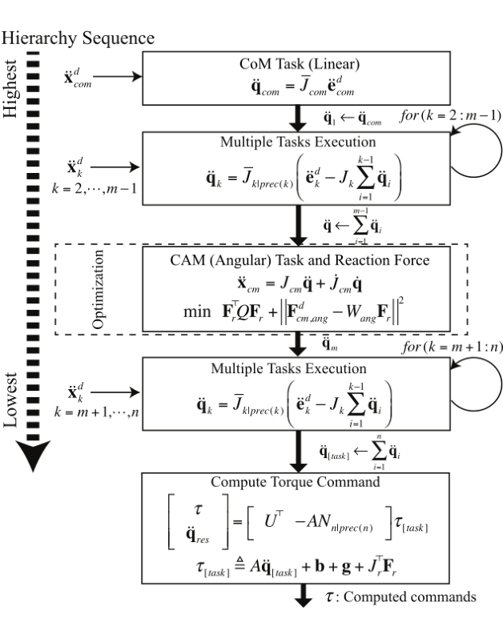

**图 7.** WBLC 通过层级零空间投影合成运动命令，并用含单边接触与摩擦锥约束的 QP 求接触反力。

## III. 全身步行控制器

WBLC 将任务定义为操作空间加速度目标，并用层级雅可比把这些目标转为关节加速度。首先，对任务 1 使用动态一致广义逆 $J_1^\#=A^{-1}J_1^T(J_1A^{-1}J_1^T)^{-1}$，其中 $A$ 是机器人惯性矩阵。任务 1 的关节加速度包含期望任务加速度与雅可比导数补偿：

$$\ddot q_1=J_1^\#(\ddot x_{d,1}-\dot J_1\dot q). \tag{6}$$

第二及后续任务经前级任务零空间投影后执行。对两个任务，形式可写为 $\ddot q=J_1^\#\ddot x_{d,1}+J_{2|1}^\#(\ddot x_{d,2}-J_2\ddot q_1)$，其中 $J_{2|1}=J_2N_1$，$N_1=I-J_1^\#J_1$。递归结构扩展到 $n$ 个任务。该方法避免了某些传统层级控制中优先级雅可比导数的计算。

### A. 欠驱动机器人反力优化

给定任务关节加速度后，WBLC 根据浮动基座刚体动力学求执行器力矩 $\tau$ 与接触反力 $F_r$：

$$A(q)\ddot q_d+b(q,\dot q)+g(q)+J_r^TF_r=U^T\tau. \tag{11}$$

其中 $b$ 和 $g$ 分别为科氏/离心项与重力项，$U$ 将驱动力矩映射到欠驱动系统，$J_r$ 为接触雅可比。质心动量任务由线动量（对应 CoM 行为）和角动量（CAM）组成。作者将 CoM 线动量作为硬约束，而把 CAM 作为较低优先级目标，并通过 QP 选择反力，使摩擦约束成立：

$$\min_{F_r}\ F_r^TQF_r+\|F_{dcm,ang}-W_{ang}F_r\|^2$$

约束包括摩擦锥不等式 $\mu|F_{r,z}|\ge |F_{r,x}|,|F_{r,y}|$，以及线动量匹配条件 $F_{dcm,lin}-W_{lin}F_r=0$。由此得到质心动量任务期望加速度，再与任务层级计算出的关节加速度合并。最终将欠定动力学方程用 Moore–Penrose 伪逆求解，得到力矩命令和残余关节加速度。

## IV. 雅可比时间导数

快速运动的操作空间控制需要补偿 $\dot J\dot q$。若忽略该项，即使使用相同的 PD 目标，末端跟踪也会变差。作者用三自由度平面机械臂跟踪 2 Hz 垂直正弦轨迹，比较是否包含 $\dot J\dot q$ 的控制器；包含该项的跟踪更准确。WBLC 在任务加速度公式中显式使用该补偿。

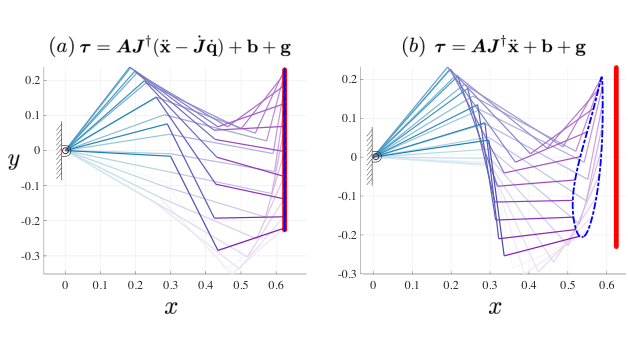

**图 8.** 三自由度机械臂跟踪 2 Hz 竖直轨迹；补偿 $\dot J\dot q$ 的控制器跟踪误差更小。

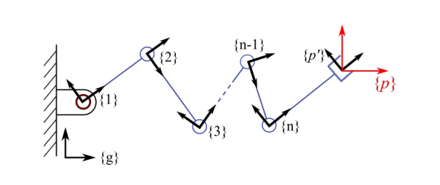

**图 9.** 由 $n$ 个关节构成、末端连接在第 $n$ 连杆上的开链机构。

### A. 点雅可比导数

刚体位姿用齐次变换 $T_{g,i}\in SE(3)$ 表示，空间速度用李代数 $se(3)$ 中的六维向量表示。借助伴随映射 $\operatorname{Ad}_{T_{i,j}}$，可把各连杆关节速度变换到末端坐标系，得到点雅可比 $J_p$。再对伴随映射求导，可解析得到 $\dot J_p$，避免数值微分。实现使用 Rigid Body Dynamics Library。

### B. 质心动量雅可比导数

点雅可比的方法不能直接用于质心动量雅可比。作者利用操作空间动力学：$\Lambda_{cm}\ddot x+\mu_{cm}+p_{cm}=F_r$。质心动量空间不存在科氏与离心项，因此有

$$\dot J_{cm}\dot q=J_{cm}A^{-1}b. \tag{31}$$

右侧各项可由常用刚体动力学库计算。

## V. 仿真结果

测试平台为 NASA Valkyrie 的三维物理模型，Finger 和 wrist 关节固定后，模型包含 28 个关节。仿真地面摩擦系数为 0.8，WBLC 的摩擦锥采用较保守的 0.65。若反力优化器找不到可行解，允许短暂放宽至 1.75；由此产生的滑移通常少于 0.005 秒。

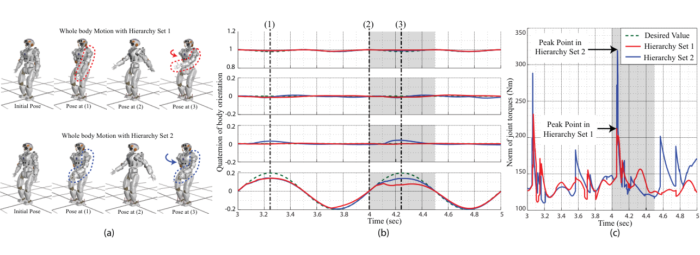

**图 10.** 两种任务优先级会产生不同的全身动作、姿态误差和关节力矩。

### A. 不同任务优先级下的躯干姿态控制

作者比较两种层级。两者都包含线性 CoM、CAM、躯干姿态、部分关节姿态、骨盆姿态及全关节姿态任务，但第二种层级将躯干姿态和关节姿态放在 CAM 之前。第二种配置的躯干抖动跟踪误差更小，但需要更高力矩；两种层级产生不同的全身补偿动作。这说明 WBLC 可用任务优先级在不同身体目标间分配控制资源。

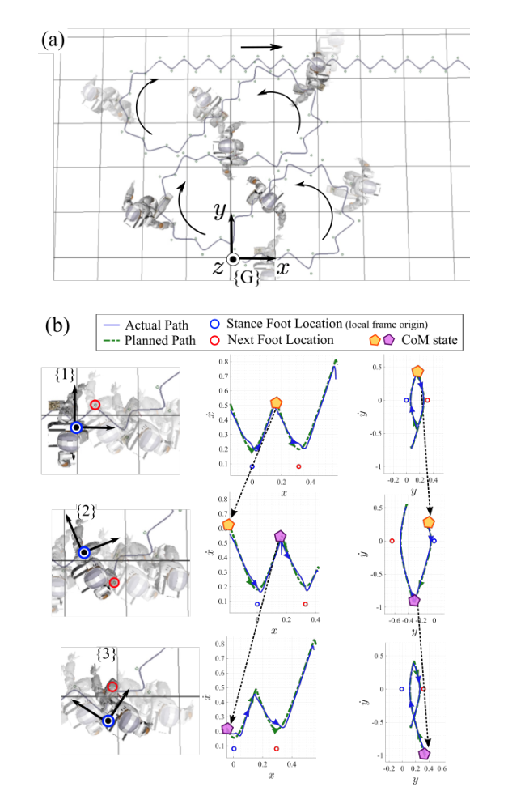

**图 11.** Valkyrie 在行走中按用户指定方向连续转向；PSP 自动计算落脚点和时序。

### B. 行走中改变方向

行走分为双支撑、右脚单支撑和左脚单支撑阶段。控制层级包括 CoM 位置、骨盆和躯干朝向、单支撑期摆动脚姿态与位置、颈部/躯干姿态、CAM 和手臂姿态。摆动足轨迹用三次 B 样条生成，保证加速度连续。Valkyrie 连续 12 步每步改变方向 18.8°，再直行 5 步，然后连续 12 步每步向反方向改变 18.8°。使用者仅指定方向，RL-PSP 自动给出落脚位置与时序，LIPM 解析式在运行时生成 CoM 的期望位置、速度和加速度。

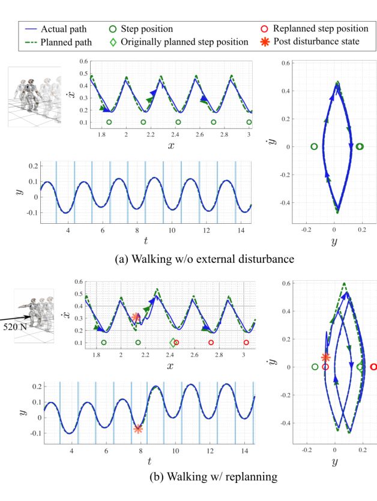

**图 12.** 骨盆受到 520 N、持续 0.1 秒的冲量后，Valkyrie 重新规划并保持行走。

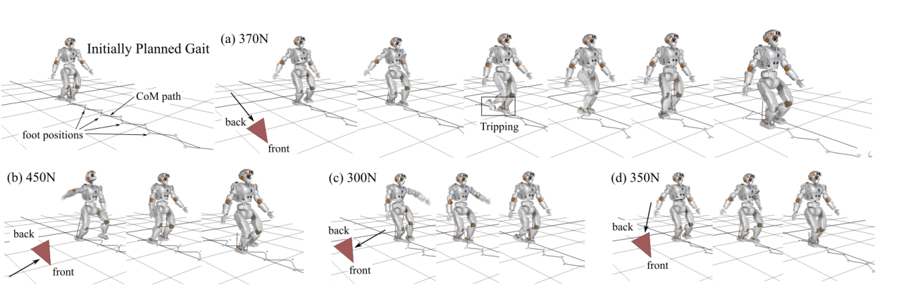

**图 13.** 在不同方向推力下恢复行走；其中一次双脚碰撞后规划器仍找到恢复路径。

### C. 行走中的推力恢复

当 CoM 状态误差超过阈值并持续一段时间，规划器从当前受扰状态重新规划。新的 CoM 目标取原目标和当前状态的加权平均 $x_{new}=\gamma x_d+(1-\gamma)x$，实验采用 $\gamma=0.8$。机器人在动态行走中承受多方向、持续 0.1 s 的推力，最大幅值为 520 N。受到扰动后，规划器能迅速调整侧向相空间轨迹并生成新的摆动脚轨迹。双核 3.0 GHz Intel i7 上，扰动后规划 15 步耗时不足 1 ms。多组不同方向和强度的推力试验中，Valkyrie 均能恢复并继续行走；有一次双脚发生碰撞，但规划器仍找到恢复路径。

## VI. 结论与讨论

本文提出 RL 鲁棒动态步行规划器和 WBLC。PSP 与 RL 将多步轨迹规划转为低维策略学习，使规划速度远高于步态周期；WBLC 则显式处理真实接触与摩擦锥约束，同时保留任务优先级。作者认为，学习到的价值函数也可作为步态风险指标，因为它综合反映运动状态、落脚和摆动时限等运动学/动力学限制。

未来计划包括采用更复杂网络表示策略和价值函数，以覆盖粗糙地形、行走、奔跑、跳跃等更多运动模式；并在真实机器人上实现算法，测试其抗扰能力。本文实验仅在 Valkyrie 物理仿真中完成，实机验证仍待开展。

## 附录 A：相空间规划解析解

在分段线性 CoM 高度表面下，PIPM 的矢状状态有解析解：

$$x(t)=Ae^{\omega t}+Be^{-\omega t}+p_x,\qquad \dot x(t)=\omega(Ae^{\omega t}-Be^{-\omega t}). \tag{35}$$

常数 $A,B$ 由初始位置、速度和支撑脚位置确定。通过连续两步相轨迹的交点求得切换状态，再以对数形式求切换时间和顶点时间；在额状方向用相同动力学求侧向落脚位置。这样避免在线数值积分和搜索。

## 附录 B：层级关节加速度等价推导

附录从关节速度分解 $\dot q=J_1^\#\dot x_1+N_1\dot q_0$ 出发，对其求导，推导与正文递归优先级控制相等价的加速度形式。导数中包括伪逆、零空间投影和第二任务雅可比的时间导数项；通过投影恒等式化简后，得到不需直接求优先级投影导数的表达式。

## 附录 C：相关工作

强化学习步态规划相关工作包括周期步态学习、基于捕获点的推力恢复和在线模型预测控制。与依赖已有稳定步态或人工轨迹的方法不同，本文重点从简化倒立摆模型出发，学习非周期、可应对多方向大扰动的规划策略。全身控制研究则涵盖投影式任务优先级、QP/HQP 接触反力优化、关节限制与碰撞约束。本文的 WBLC 让低维 QP 只处理接触反力，使计算量主要随接触点数量变化，同时用投影式加速度控制保持任务优先级。

## 致谢与参考文献

作者感谢德州大学奥斯汀分校 Human Centered Robotics Laboratory 成员的帮助。研究获得美国海军研究办公室资助。参考文献保留英文，见项目 `source-pages/page-14.txt` 和随附 PDF。
