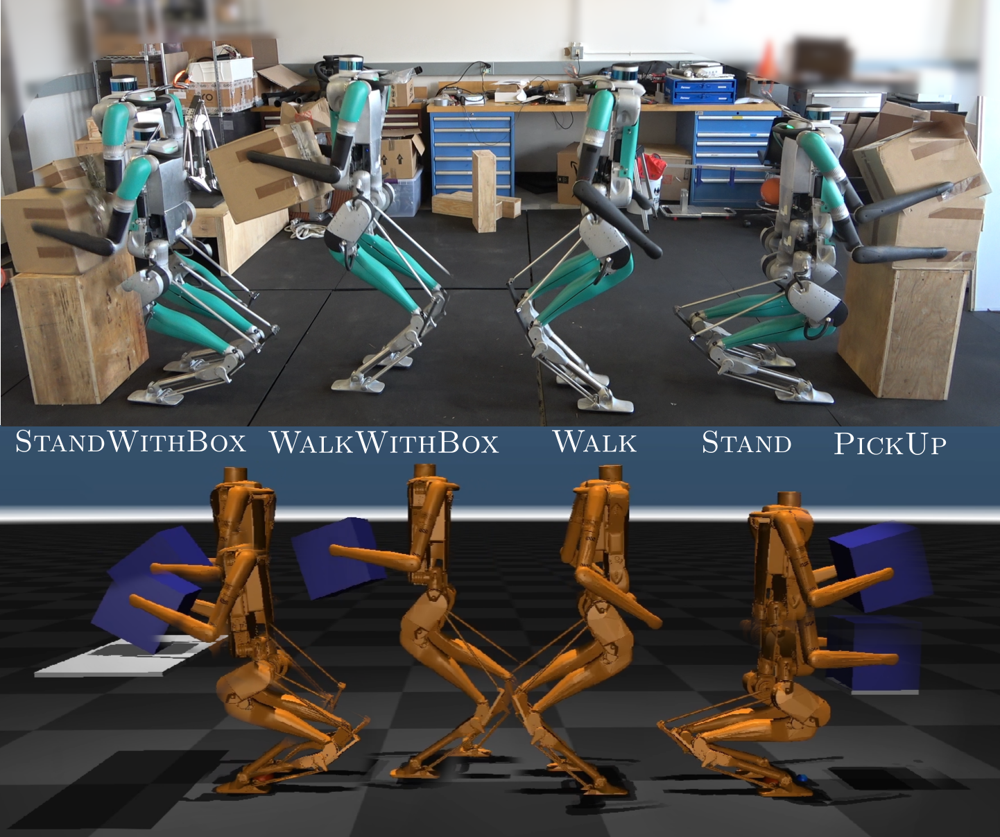
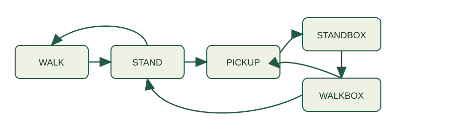
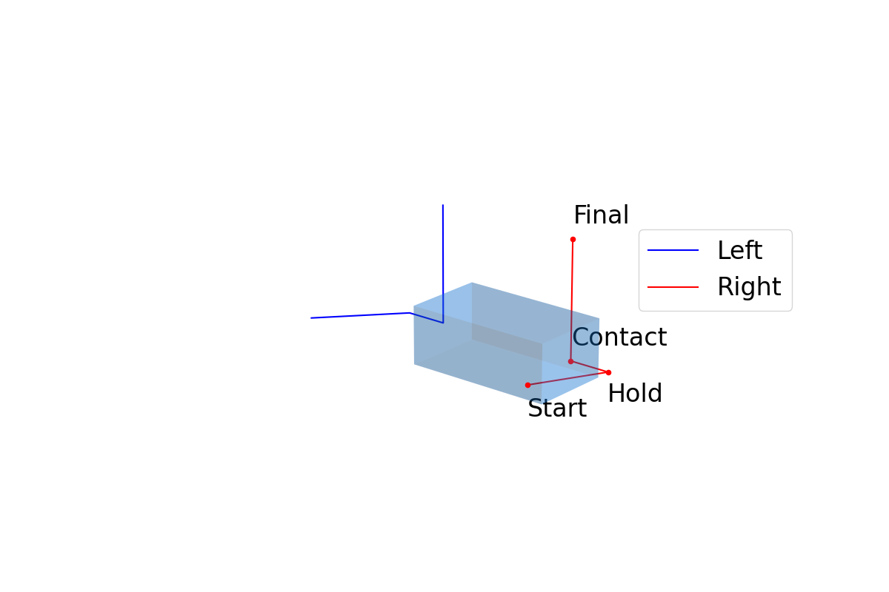
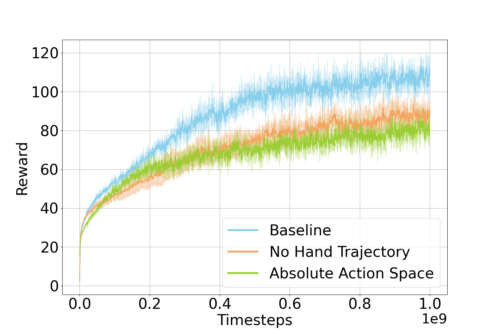

# 人形机器人箱体移动操作的仿真到现实学习

**Jeremy Dao、Helei Duan、Alan Fern**  
arXiv:2310.03191v1，2023 年 10 月

## 摘要

本文提出一种面向人形机器人的箱体移动操作学习方法。机器人需要协调全身动作，在保持平衡的同时搬起不同重量、位置和朝向的箱子，这使任务尤具挑战性。作者采用仿真到现实（sim-to-real）强化学习，为 Digit 双足机器人学习具有泛化能力的箱体抓取和搬运技能。奖励函数既引导机器人与箱子按期望方式交互，也兼顾平衡与步态质量。作者将多个技能组合成完整系统，使机器人能把不同尺寸、质量和初始摆放的箱子从一张桌子搬到另一张桌子。除仿真定量结果外，论文还展示了在 Digit 实机上的成功迁移。据作者所知，这是首次在真实人形机器人上实现学习控制器完成此类移动操作任务。

## I. 引言

腿式机器人强化学习主要研究行走、奔跑和复杂地形导航；物体操作的强化学习则多针对固定或稳定基座的机械臂。腿式机器人移动操作同时包含移动和物体操纵，研究相对较少。作者要解决的任务是：机器人走到箱子前、停下、搬起箱子、将其运到另一张桌子并放下。数据驱动学习有望使技能适应不同箱体尺寸、质量、姿态和位置，但箱体搬运要求全身动作协调，还要在动作平顺、不过度用力和保持平衡之间取得平衡。

传统模型方法能规划抬箱时的全身运动并补偿箱体施加的额外力，但为保证始终稳定，动作往往非常保守，完成一次拾取可能需要 20 秒以上。规划方法也已用于生成较长移动操作轨迹。既有学习研究多依赖遥操作或人体动作捕捉提供示范轨迹，这会引入演示采集、运动跟踪和人与机器人动作对齐误差。移动底盘或四足机器人常将行走和机械臂操作分成两个控制模块；本文也采用技能分解，但每个学习策略都控制 Digit 的全身关节，因此行走与操作之间仍可形成协调动作。

本文贡献如下：第一，设计包含接触时机、手部目标轨迹、箱体作用力和平衡项的拾取奖励，使动作平顺且不过度冲击；第二，发现拾取策略采用“相对”动作空间更利于学习，即将策略输出叠加到当前关节位置，而不是固定中立姿势；第三，将行走、站立、拾取、抱箱行走和抱箱站立分别训练，再组合成完整系统，并在 Digit 实机展示 sim-to-real 移动操作。

### A. 人形机器人移动操作

既有模型式人形机器人拾取方法可以在严格稳定约束下规划搬运动作，但动作偏慢。面向长时序移动操作的规划方法已展示部分硬件结果；另有研究通过调整步态来配合物体操作。本文关注数据驱动的全身策略，直接从仿真学习与箱体接触的动作。

### B. 移动操作强化学习

先前工作多使用带机械臂的移动底盘或四足机器人，并将行走与抓取分成模块。本文的技能也分开训练，但学习策略控制所有可驱动关节，因而可以协调腿、躯干与手臂。与基于遥操作、动作捕捉示范的模仿学习不同，本文以奖励为基础学习动作。

**图 1.** 仿真中学习五项技能并迁移至实机。

## II. 系统概览

完整任务分成五种行为：**WALK**（基本行走）、**STAND**（由行走转为站立）、**PICKUP**（拾取箱体）、**WALKWITHBOX**（抱箱行走）和 **STANDWITHBOX**（抱箱站立）。系统只允许特定技能转换，例如行走后先站稳再拾取，不会从行走直接跳到拾取。这样，每种策略可以为下一项技能生成有代表性的初始状态。行为转换时，在新旧策略动作间用 10 个控制时步线性插值，训练时也包含此动作预热过程。

Digit 有 20 个自由度，其中 10 个未驱动自由度。每个策略接收 67 维机器人状态 $s$ 和策略专属命令 $c$，以 50 Hz 输出各驱动关节的 PD 目标；固定增益 PD 控制器以 2 kHz 执行。策略采用两个 128 维循环隐状态层的 LSTM。训练使用 MuJoCo、PPO（近端策略优化）和梯度裁剪，并对身体质量、关节阻尼、质心位置、地面摩擦等进行动力学随机化。训练和测试直接使用仿真真值状态，并叠加随机噪声。

各奖励写成若干代价项 $r_i$ 的加权指数和：

$$R=\sum_i w_i\exp(-r_i).$$

代价越大，对应奖励越小。不同技能共享学习框架，但按目标调整奖励项。

**图 2.** 五种策略之间的允许转换关系。此图依据正文描述重绘。

## III. 移动操作技能学习

### A. 箱体拾取策略

拾取策略要处理不同尺寸和重量的箱子、不同起始位置和方向，并生成平顺、速度适中的动作。行为分为两个阶段：**接触阶段**中双手向箱体移动并建立接触；**抬升阶段**中双手将箱子移动到目标位置。论文以策略启动后的步数表示阶段时钟：接触阶段在 $t_{contact}=100$（2 秒）结束，抬升阶段在 $t_{lift}=175$（3.5 秒）结束。命令包括箱体尺寸、质量、起始位姿、目标位置，以及两个随阶段线性变化的进度信号。

为方便硬件测试，策略只显式使用行为开始时的箱体位姿；箱子移动后，以左右手位置的平均值近似箱体中心，避免依赖实时箱体位姿估计。箱子初始位置在机器人前方 35–50 cm、左右 ±30 cm 范围内，地面高度至 1.3 m；初始偏航角在 ±22.5° 内。目标位置采用类似范围，但目标高度只允许在初始位置上方。箱体长、宽、高各在 20–45 cm 之间，质量在 1–10 kg 之间。

手部目标轨迹由若干带时间戳的目标点线性插值得到：先将手放到箱体两侧，再在接触阶段结束时贴住箱体侧面，随后在抬升阶段将手移至目标位置两侧。实验发现，在奖励中显式提供手部轨迹能显著加快训练，也提升实机成功率。

拾取奖励由轨迹项、箱体交互项、站立稳定项和动作调节项组成：

- **轨迹项**：双手跟随期望位置，并保持手部滚转角接近零。
- **箱体项**：在正确时刻与箱体接触、将其抬离桌面、移动到目标位置，并保持箱体水平。接触奖励只在接触阶段末尾启用，以避免过早碰撞。
- **站立项**：保持质心投影/压力中心（CoP）位于支撑区域中央，躯干竖直、双脚朝前，降低关节电机速度并抑制足端速度。
- **平滑项**：抑制动作变化、关节力矩、手部接触力和箱体加速度，使机器人与箱体的交互更柔和。

如果发生自碰撞、手部速度超过 1 m/s、躯干高度低于 40 cm、躯干俯仰超过 35°、任一脚离地，或阶段超时未完成，则终止训练回合。箱体质量额外随机 ±0.5 kg、尺寸 ±5 cm、起始位置 ±5 cm。

**图 3.** 双手先移至箱体两侧、接触箱体，再将其搬至目标位置的示例轨迹。

拾取奖励中各项权重见表 III：手部位置 0.15、手部滚转 0.05、箱体位置 0.15、箱体朝向 0.05、桌面作用力 0.05、CoP 0.1、躯干朝向 0.05、足部朝向 0.1、电机速度 0.05、足速 0.05、手部作用力 0.05、箱体加速度 0.05、动作变化 0.05、关节力矩 0.05。

### B. 行走策略

普通行走策略沿用既有双足 sim-to-real 学习设置，并增加手臂位置奖励，使双手始终位于躯干前方且彼此保持合理间距。抱箱行走策略采用相近设置，命令额外包含箱体尺寸、质量和抱持高度。每个训练回合随机设置初始步态、前进速度（−0.5 至 1.0 m/s）、侧向速度（−0.3 至 0.3 m/s）、转向角速度（−π/8 至 π/8 rad/s）和箱体高度（1.0–1.3 m）；运行中还会再次随机化命令。抱箱行走会惩罚箱体偏离期望高度、箱体倾斜和手部过大作用力；若手失去箱体接触则终止回合。

### C. 站立策略

普通站立策略把行走状态转换为静止站立，不接收额外命令，只输入机器人状态。奖励包括降低基座速度、保持基座高度约 0.9 m、维持双脚间距约 0.385 m、避免两脚前后错位，并将手臂保持在躯干前方。抱箱站立策略额外输入箱体尺寸、质量和抱持高度，继续使用箱体位置、方向与接触奖励；若任一只手失去箱体接触则终止。

### D. 技能转换

策略按前述有限状态流程依次训练：先训练普通行走，再用行走策略产生低速状态训练站立；站立终态作为拾取策略的起始状态；随后训练抱箱站立和抱箱行走。训练数据保存机器人状态及最近一次动作，以便新策略接续时执行 10 步动作插值，实现平滑切换。

## IV. 仿真结果

每项策略在 MuJoCo 中用 10,000 个随机回合评估。若机器人没有摔倒，且涉及箱体的策略在结束时仍握住箱体，则记为成功；箱体任务还统计成功回合中箱体最终位置与目标位置的距离。

| 行为 | 成功率 | 箱体位置误差 |
|---|---:|---:|
| PICKUP | 96.15% | 7.93 cm |
| STAND | 100% | 不适用 |
| STANDBOX | 95.25% | 1.64 cm |
| WALK | 96.1% | 不适用 |
| WALKBOX | 100% | 2.39 cm |

这些策略在训练分布产生的典型后继状态中保持较高成功率。进一步逐项增加单一箱体参数，直至拾取失败，发现策略可处理质量达 22.9 kg、尺寸达 64 cm 的箱子；训练范围分别仅为 1–10 kg 和 20–45 cm。测试还覆盖前后位置 56 cm、侧向偏移 41 cm、目标高度 130 cm 和偏航角 45° 等范围。

### 消融实验

移除手部目标轨迹奖励后，仍能学到可完成拾取的策略，但达到相同奖励水平所需样本约增加一倍。将动作改为叠加到固定“中立”姿态，而非当前电机角度，也显著降低拾取学习效率；行走和站立策略未出现同样退化。作者据此认为，当操作目标与固定姿态差异较大时，相对动作空间更合适。

**图 4.** 基线、去除手部轨迹奖励和绝对动作空间三种学习设置的奖励曲线。

## V. 硬件结果

五项策略均成功迁移到真实 Digit，并能连续完成技能转换。机器人拾取过多个尺寸和质量的箱子，质量范围为 1–8 kg；箱子可从地面或桌面开始。导航、技能切换和行走命令仍由操作员提供；箱体位姿由机载 RGB-D 相机读取箱体上的 ArUco 标记，箱体尺寸和质量预先输入策略。

实机上观察到策略有时会向一侧倾斜，作者推测与 IMU 姿态估计和仿真存在差异有关，并通过姿态输入偏置进行“质心微调”。对于 8 kg 重箱，需增加前倾修正量。作者认为这类偏差也可能来自仿真与实机的接触力差异。

## VI. 结论

本文将箱体移动操作分解为五项独立学习的行为，在 Digit 上完成了仿真训练到实机执行的迁移。策略能适应不同箱体质量、尺寸和初始位置，并完成走近箱体、拾取、搬运至目标位置和放下的整个任务。未来将通过加入规划、导航和视觉系统减少人工操作与 ArUco 标记依赖，并利用仿真及实机成功/失败样本进一步改善动力学随机化和 sim-to-real 性能。

## 参考文献

参考文献条目保留英文原文，见项目 `source-pages/page-07.txt` 和随附 PDF。
